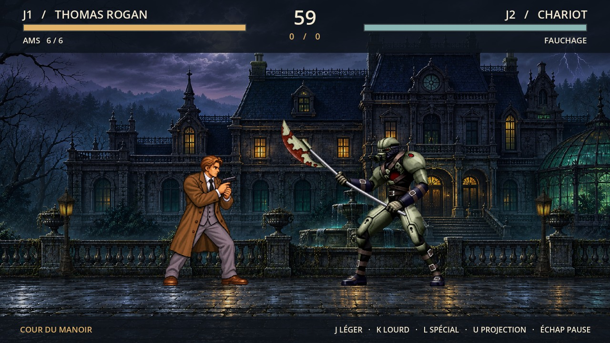
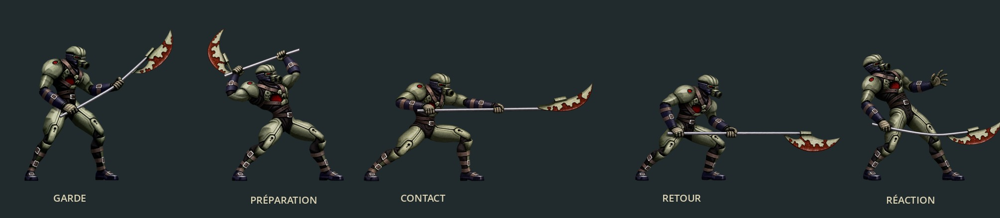
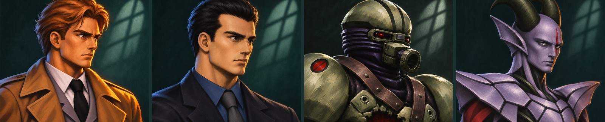
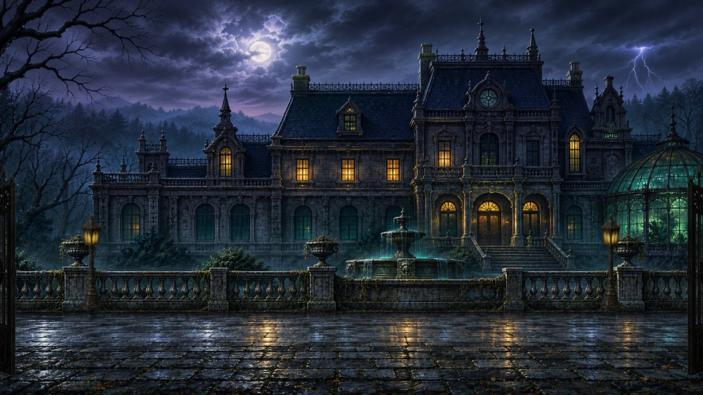
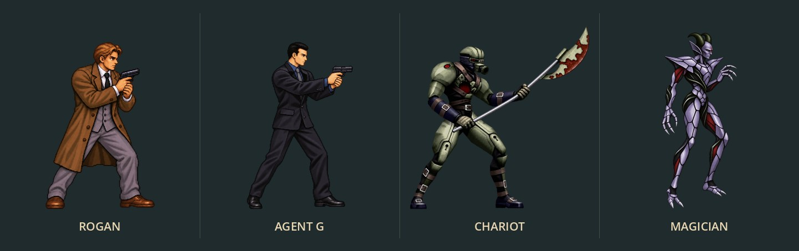
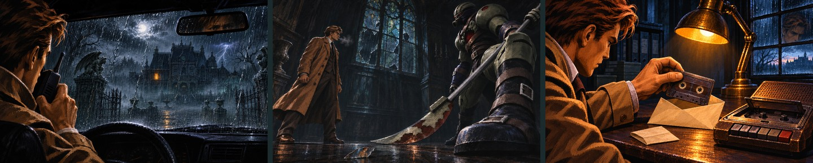

# Dossier Curien

*Bible du mode de combat 2D de The House of the Dead 2.5D • 18 novembre 2026*

Ce volume décrit le premier lot du manoir. L’état courant — 24 combattants et 20 arènes dans les sources du 20 novembre — est présenté dans la [bible de la saga](saga/BIBLE_SAGA.md), les [instructions de jeu](JOUER.md) et le [catalogue des personnages et tenues](saga/production/catalogue_2026-11-20/PERSONNAGES_TENUES.md). Les paquets antérieurs et les captures de ce volume conservent leur propre périmètre.

## Dossier Curien

Le mode de combat 2D de The House of the Dead 2.5D

### Le combat commence avant le premier tir

À l’entrée du manoir, Rogan a six cartouches. Chariot avance encore. Tirer préserve la distance mais rapproche l’instant de la recharge. Attendre laisse la bardiche gagner du terrain. Ce choix donne son rythme au duel.

L’AMS reconstitue l’incident à partir de témoignages et de bandes incomplètes. On peut revivre un échange du côté de l’agent qui l’a raconté, puis passer du côté du sujet qui occupait son champ de vision. Une route dure trois combats.

| Jouables | Arènes | Formats |
| --- | --- | --- |
| Rogan · G · Chariot · Magician | Cour du manoir · Antichambre · Laboratoire | Histoire · Duel IA ou local · Tournoi · Entraînement |

> Référence visuelle principale : borne SEGA Model 2. Les scènes, les confrontations et les commandes de ce mode sont des créations pour le projet. Version de travail du 18 novembre 2026.

## Ce qui vient de la borne

Dans le rail shooter, le danger entre dans le cadre du joueur. En vue latérale, il faut montrer quand il va atteindre la place que le joueur occupe.

| Référence de l’original | Traduction en duel | Vérification de fidélité |
| --- | --- | --- |
| Le tir et la recharge interrompent alternativement l’action. | Six témoins de munition pour les agents. Une recharge expose au retour adverse. | La main et le son expliquent l’état à distance. Aucune munition pour les sujets. |
| Les scientifiques peuvent être secourus. Des décisions ouvrent des chemins. | Une prise de risque entre deux matchs peut compléter un témoignage dans la campagne étendue. | Rogan et G restent partenaires. Un chercheur n’entre jamais dans la ligne de frappe en tournoi. |
| Un boss se lit par sa silhouette, son rythme et une faiblesse. | Carte de sujet, préparation caractéristique, récupération identifiable. La brèche du plastron guide le regard. | Vérifier la forme de la bardiche, la carte Type 27 et les plaques asymétriques du Type 0 sur l’arcade. |
| Les lieux racontent l’enfoncement dans le manoir. | Chaque duel occupe un sol horizontal au sein d’un lieu reconnaissable. | S’assurer que les éléments nécessaires au jeu restent dans la fenêtre de combat. |

### Les quatre chapitres de référence

| Chapitre | Créature | Emploi dans le mode |
| --- | --- | --- |
| Tragedy | Chariot · Type 27 | Rival de Rogan dans l’antichambre. |
| Revenge | Hangedman · Type 041 | Rencontre aérienne prévue sur les toits. |
| Truth | Hermit · Type 6803 | Rencontre hors gabarit prévue dans le puits. |
| The House of the Dead | Magician · Type 0 | Dernière confrontation de Rogan. Jouable dans sa propre reconstitution. |

> Le récit d’origine commence avec l’appel de Sophie Richards à l’AMS. La date du dossier est le 18 décembre 1998. L’architecture latérale reste une adaptation artistique.

## Une manche au manoir

Le jeu doit permettre de reconnaître le danger un instant avant le contact. Le joueur apprend à répondre d’abord par le placement, puis par une confirmation de coup.

### Règles du premier format

Deux manches gagnantes, 60 secondes par manche. Aller et venir, sauter, s’accroupir, garder en reculant, projeter, frapper léger ou lourd et utiliser le spécial du personnage composent le noyau. Les agents gèrent une réserve de six cartouches.

| Situation | Décision attendue | Réponse de l’adversaire |
| --- | --- | --- |
| Ouverture à mi-distance | Menacer d’un coup léger, se replacer et observer une réaction. | Le défenseur peut céder du terrain, garder ou sauter une attaque annoncée. |
| Attaque lourde dans le vide | L’attaquant reste engagé jusqu’au retour en garde. | Le défenseur avance pendant la fin du geste et reprend son tour. |
| Garde au contact | La garde arrête la pression frontale. La projection exige la proximité. | Rompre la distance ou décoller avant la saisie. |
| Dernière cartouche | Rogan ou G peut l’employer pour gagner la distance de recharge. | Le rival surveille l’indicateur et ferme l’espace dès l’animation. |
| KO décisif | Le vainqueur peut déclencher une fatalité pendant la fenêtre affichée. | La fin de la fenêtre valide aussi la victoire et fait avancer le mode. |

### Équilibrage cible à 60 Hz

Une image de simulation dure 16,7 ms. Pour les coups de base, tester un léger à 5 images de départ, 3 actives et 10 de récupération, puis un lourd à 12 / 4 / 20. Valider d’abord le coup manqué à distance maximale. Ajuster ensuite l’avantage sur garde, puis les dégâts.

Cible des combos étendus : l’annulation lourd → spécial exige un impact confirmé. Multiplier les dégâts des touches successives par 1,00, 0,85, 0,70 puis 0,55. Une seule relance aérienne par séquence. Les coups ajoutés en production doivent passer ce test des deux côtés du terrain.

> Les chiffres de réglage et commandes directionnelles des fiches sont des cibles de production. La première version propose déjà un spécial direct par combattant.

## Quatre spéciaux déjà jouables

Sur le terrain de 1 280 unités, chaque spécial a trois images actives. La différence se ressent dans la portée, le départ et le temps qu’il faut pour retrouver sa garde.

| Combattant | Spécial en jeu | Départ / fin | Dégâts / portée | Finition en jeu |
| --- | --- | --- | --- | --- |
| Rogan | Tir AMS | 12 / 38 | 10 / 700 | Sceau AMS |
| G | Tir réflexe | 8 / 32 | 8 / 530 | Extinction des feux |
| Chariot | Fauchage | 22 / 53 | 23 / 245 | Sentence de fer |
| Magician | Orbe thermique | 20 / 48 | 15 / 760 | Combustion |

Le compteur commence à l’engagement. Le Fauchage peut toucher aux images 22, 23 ou 24 et cesse à l’image 53. À portée courte, le Tir réflexe de G sort plus vite. À longue distance, Rogan porte plus loin. Un agent qui s’accroupit peut passer sous la trajectoire d’un tir AMS.

### Lire le retour de la bardiche

La garde laisse lire la brèche. La préparation ramène la bardiche derrière l’épaule. Au contact, la lame occupe une grande partie de l’espace devant le sujet. Elle revient ensuite en position basse avant la garde. La réaction à un impact déplace le torse sans déplacer artificiellement les pieds. La toile de contact est plus large pour conserver toute la lame.

> Valeurs du prototype dans src/dossier_curien/combatant.gd. Les fiches individuelles développent des mouvements supplémentaires et des versions cinématiques pour la suite.

## Commandes et lecture des coups

L’entrée du mode se trouve dans le menu principal de Godot. Choisir Dossier Curien — Combat 2D, puis le format et le combattant.

| Action | Joueur 1 | Joueur 2 | Manette |
| --- | --- | --- | --- |
| Avancer / reculer | ← / → | Q ou A / D | Croix gauche / droite |
| Saut / accroupi | ↑ / ↓ | Z ou W / S | Croix haut / bas |
| Garder | Reculer | Reculer | Direction opposée au rival |
| Léger / lourd / spécial | J / K / L | F / G / H | A / X / B |
| Projection | U | T | Y |
| Recharge des agents | R | E | LB |
| Fatalité | I | Y | RB |
| Pause | Échap | Échap | Start |

### Lire les fiches avancées

L désigne le bouton léger, H le lourd et S le spécial. Les directions sont relatives à un rival situé à droite. Inverser les directions horizontales quand le combattant change de côté. Les flèches entre les noms de boutons, dans un enchaînement, donnent l’ordre des actions.

Exemple : la commande ↓ ↘ → + S de Rogan décrit un mouvement directionnel puis une pression sur spécial. La version jouable se prend en main avec la touche directe de spécial. Les supers et leurs commandes complètes appartiennent au système avancé décrit ici.

### Premier exercice

Prendre Rogan contre Chariot. Avancer jusqu’à ce que le bout de la bardiche menace, reculer, puis engager un léger après un coup adverse manqué. Au deuxième essai, dépenser la dernière cartouche et chercher assez d’espace pour recharger. Inverser les rôles pour éprouver la même situation du côté de Chariot.

> Le mode Entraînement sert à répéter cet échange. L’affichage des données par image, l’enregistrement du mannequin et les défis de confirmation sont spécifiés pour la suite.

## Du duel au tournoi

Chaque format répond à un usage différent. La même géométrie de contact et les mêmes attaques doivent rester reconnaissables dans tous les formats.

| Format | Déroulement | Décision de conception |
| --- | --- | --- |
| Histoire | Choisir un point de vue. Introduction, premier duel, scène de rival, dernier match, fin. | Un échec ramène au combat concerné. L’option de reprise de chapitre constitue une cible de progression. |
| Duel contre IA | Choisir son combattant puis son adversaire et entrer en arène. | Les affrontements entraînent une lecture de portée, de saut et de garde. |
| Duel local | Deux joueurs, une arène, deux manches gagnantes. | Les deux côtés doivent accepter les mêmes coups et pouvoir inverser leurs places. |
| Tournoi initial | Quatre participants distincts, deux demi-finales puis une finale. Le joueur dispute au plus deux matchs. | La deuxième demi-finale fournit l’adversaire potentiel du joueur. Le tableau doit indiquer qui progresse. |
| Entraînement | Choisir le personnage et travailler face à un mannequin. | Répéter garde, reprise après une attaque manquée et recharge. Le bilan avancé précisera les entrées et les fenêtres. |

### Extension du tournoi

Étendre à huit puis seize inscriptions lorsque le roster le permet. Geler les têtes de série à la validation du tableau, sauvegarder l’identifiant du vainqueur après chaque rencontre et ne jouer que les matchs devenus résolubles. Un doublon de personnage entre joueurs emploie un repère d’équipe lisible en niveaux de gris.

Règle cible de compétition : une finale gagnée par forfait s’affiche comme telle. En cas de coup simultané décisif ou d’égalité parfaite au temps, rejouer une manche courte en conservant les côtés. Tester les cas limites avant d’ouvrir un classement.

> Les duels en ligne et le rollback relèvent d’un chantier de réseau distinct. L’édition initiale se pratique en local.

## Quatre lectures du même incident

L’AMS compare les enregistrements. Les duels G–Rogan sont des simulations d’entraînement. Les routes des sujets sont des hypothèses de reconstruction.

| Point de vue | Ouverture | Rival | Dernier duel |
| --- | --- | --- | --- |
| Rogan | G · Cour | Chariot · Antichambre | Magician · Laboratoire |
| G | Rogan · Cour | Magician · Laboratoire | Chariot · Antichambre |
| Chariot | G · Cour | Rogan · Antichambre | Magician · Laboratoire |
| Magician | Chariot · Antichambre | G · Laboratoire | Rogan · Cour |

### Monter une séquence

Ouvrir sur un détail que le joueur retrouvera dans le combat. Chez Rogan, l’appel de Sophie arrive avant le visage de l’agent. Chez Chariot, le bruit du métal précède l’entrée du casque dans le champ. Le carton du rival apparaît avant que les deux silhouettes adoptent leur garde.

Après le dernier match, rendre le point de vue à l’observateur. L’illustration d’ending répond au premier plan de la route, puis le dossier rejoint le registre de l’AMS. Le texte reste consultable pour qu’un joueur qui passe les cinématiques puisse retrouver la fin obtenue.

### Embranchement sauvegarde des témoins • cible

Après le premier combat d’un agent, une porte de service résonne. La vérifier déclenche un bref défi d’interception et recueille un témoignage. La laisser fermée donne le même rival, avec une bande son incomplète. Au dernier plan, une voix supplémentaire ou un siège vide rend le choix visible. Le tournoi ignore cette variable.

> Dialogues et scènes sont écrits pour ce mode. Une fin de reconstitution ne décide pas du sort de Sophie dans la campagne sur rails.

## Thomas Rogan

Pression à moyenne portée

Agent de l’AMS appelé au manoir par Sophie Richards. Dans la capture arcade devant le manoir, Rogan porte un manteau brun sur un costume gris, une chemise blanche et une cravate noire. La munition achète du terrain. Chaque tir dépensé raccourcit la prochaine séquence offensive. Le pardessus doit laisser voir le retour à la garde.

| Action et commande cible | Effet et fenêtre proposés | Contre-jeu |
| --- | --- | --- |
| Tir de barrage ↓ ↘ → + S | Une cartouche. Projectile horizontal haut, départ en 12 images. Maintenir avant pendant le tir fait avancer Rogan d’un demi-pas. | S’accroupir sous le tracé. Le demi-pas expose Rogan à la sortie du tir. |
| Appel de phare → ↓ ↘ + S | Une cartouche. Le faisceau monte en diagonale après 8 images et interrompt une approche aérienne. La ligne passe au-dessus d’une cible accroupie. | Feinter le saut ou rester au sol. Rogan attend 23 images avant de retrouver sa garde. |
| Repli sous le porche ↓ ↙ ← + S | Petit retrait qui recharge deux cartouches à l’image 19. La réserve reste plafonnée au maximum des agents. | Le froissement du manteau annonce le recul. Avancer dès le premier pas interrompt la recharge avant son bénéfice. |
| Super · Ligne d’évacuation ↓ ↘ → + H et S | Une jauge pleine. Les phares de la berline découpent un couloir horizontal. La première touche confirme une courte rafale de trois impacts. | Garder dès l’allumage des phares. Un premier impact bloqué supprime la rafale et laisse Rogan à portée. |

### Enchaînement • Du seuil au couloir

L → H → ↓ ↘ → + S — À portée courte, le léger confirme le fort, annulable au premier impact vers Tir de barrage. Coût prévu d’une cartouche. Rester en garde sur L. Si H arrive dans la garde, le projectile haut peut être esquivé en s’accroupissant.

### Scènes du parcours

| Moment | Mise en scène |
| --- | --- |
| Intro | Une sonnerie couvre le moteur de la berline. Rogan arrête l’enregistrement sur le premier mot de Sophie. G ouvre le portail. « Garde la ligne ouverte. » La reconstitution AMS commence. |
| Rival | Chariot · La verrière. Un éclat de verre roule entre les chaussures de Rogan. On entend G évacuer la pièce voisine. Rogan arrête de reculer quand le talon de Chariot écrase l’éclat. |
| Fin | Après Magician, le laboratoire devient une image fixe. Rogan rembobine jusqu’au coup de téléphone initial. Il range la cassette dans l’enveloppe de l’affaire et conserve le petit papier où il a noté l’heure de l’appel. |

## Agent G

Interception et contrôle du rythme

Partenaire de Rogan à l’AMS. Devant la porte du manoir, G porte un costume presque noir, une chemise bleue et une cravate gris sombre. G gagne du terrain en lisant le prochain engagement adverse. Ses tirs courts et ses interceptions lui laissent peu de marge si sa lecture est fausse.

| Action et commande cible | Effet et fenêtre proposés | Contre-jeu |
| --- | --- | --- |
| Ligne bleue ↓ ↘ → + S | Une cartouche. Un trait bleu marque la mi-hauteur. Le projectile unique part à l’image 15 et s’efface à deux tiers d’écran. | Reculer au-delà de sa portée ou sauter pendant le marquage. G reste sur place. |
| Interception ↓ ↙ ← + S | Fenêtre de 6 images pour annuler un projectile simple qui touche le réticule. Sur succès, G récupère une cartouche, dans la limite de sa réserve. | Retarder le projectile ou entrer au contact. Une interception à vide laisse G occupé pendant 18 images. |
| Angle mort → ↓ ↘ + S | G se baisse, disparaît derrière un reflet du moniteur et avance d’une largeur de corps. Il passe sous les projectiles hauts à partir de l’image 7. | Un coup bas couvre son arrivée. Le reflet annonce le point où il se redresse. |
| Super · Déposition ↓ ↘ → + H et S | Une jauge pleine. Pendant 18 images, le viseur enregistre le premier coup direct reçu. Si le contact survient, l’enregistrement repart en sens inverse et G prend l’avantage. | Attendre que le petit voyant s’éteigne ou lancer une projection. La pose à vide laisse le viseur sans défense. |

### Enchaînement • Rapport en deux temps

↓ + L → H → ↓ ↘ → + S — À courte portée, la touche basse ouvre la confirmation vers le fort, puis Ligne bleue. La dernière touche éloigne l’adversaire sans changer de côté. Garder bas au départ. Si le premier coup manque, l’avancée de G s’arrête et le fort devient évitable.

### Scènes du parcours

| Moment | Mise en scène |
| --- | --- |
| Intro | G règle le son d’un magnétophone. La piste de Rogan sature à l’ouverture du portail. Il bascule sur le second canal, où l’on distingue encore les pas des chercheurs. « On en compte combien ? » |
| Rival | Magician · La salle d’essai. Dans la vitre de contrôle, G aperçoit le reflet de la créature avant sa silhouette. Il pose deux doigts sur la touche de lecture. « Une fois. À vitesse réelle. » |
| Fin | La reprise s’arrête sur Chariot, dernier sujet de l’exercice. G coupe le son des chocs et remonte le canal des voix. Une personne que le premier écouteur ne distinguait pas répond à l’appel. Il corrige le registre des rescapés dans le compte rendu de simulation. |

## Chariot · Type 27

Allonge au sol et pression d’armure

Premier boss du manoir. Sa silhouette tient à son armure, à la brèche qui la rend vulnérable et à sa longue bardiche. Sa seconde forme expose le corps. Le pilote de la reconstitution doit accepter les longues reprises d’équilibre du sujet. L’armure protège une approche précise. L’angle de la lame permet de lire la hauteur avant le contact.

| Action et commande cible | Effet et fenêtre proposés | Contre-jeu |
| --- | --- | --- |
| Arc de fonte ↓ ↘ → + S | Grand balayage horizontal, départ en 18 images. La pointe atteint presque un demi-écran. Frapper avec le manche repousse moins. | Rester hors de la pointe puis avancer pendant la récupération. La garde protège sur toute la largeur de l’arc. |
| Marche du sujet 27 ↓ ↙ ← + S | Deux pas pesants. La protection absorbe un impact frontal entre les images 7 et 17. L’ouverture du plastron luit lorsqu’elle a servi. | Une projection ou deux touches espacées percent la marche. Chariot peut aussi être contourné par un saut anticipé. |
| Retour de hampe → ↓ ↘ + S | La hampe monte presque à la verticale après 10 images. Sa couverture est forte au-dessus du casque et courte devant les pieds. | Couper son approche avant la montée, ou attendre au sol que la hampe retombe. |
| Super · Chute de la verrière ↓ ↘ → + H et S | Une jauge pleine. La bardiche frappe la charpente du décor virtuel. Trois bandes d’ombre annoncent successivement les zones où tombent les éclats. | La première bande traverse le centre. Lire les deux suivantes et avancer dans la zone qui vient de se vider, ou maintenir la garde. |

### Enchaînement • Ferrure et verrière

L → H → ↓ ↘ → + S — À bout de manche, le léger amène l’adversaire à la distance du fort. Annuler ce dernier sur touche seulement vers Arc de fonte pour le repousser. Bloquer le premier contact. Sur un fort gardé, l’annulation disparaît et la reprise de la bardiche devient punissable.

### Scènes du parcours

| Moment | Mise en scène |
| --- | --- |
| Intro | La caméra d’expertise est couchée au sol. Une semelle métallique s’arrête dans le cercle de mise au point. Une main soulève la bardiche. La bande de test émet deux bips et la silhouette de G apparaît. |
| Rival | Rogan · Derrière le verre. Le pardessus de Rogan se reflète sur le plastron. Au premier mouvement du viseur, l’armure pivote et le reflet disparaît dans la brèche. Chariot gratte la dalle d’un seul pas. |
| Fin | Le modèle de Magician s’éteint. Encore en mouvement, Chariot traverse le trait blanc qui borne la salle virtuelle. Le film s’arrête sur son pied levé. Dans la régie, un opérateur entoure à la main la dernière image exploitable. |

## Magician · Type 0

Mobilité et contrôle aérien

Ultime création de Curien dans l’incident du manoir. Le projet conserve ses charges, ses boules de feu et les zones rouges visibles entre les plaques. Magician choisit où le prochain échange aura lieu. Le trait de feu donne à l’autre joueur un repère avant le déplacement. Les longues préparations restent vulnérables.

| Action et commande cible | Effet et fenêtre proposés | Contre-jeu |
| --- | --- | --- |
| Feu suspendu ↓ ↘ → + S | Après 16 images, pose une sphère qui reste suspendue 20 images avant de traverser l’écran. Limite d’une sphère active par joueur. | Intercepter la sphère avant sa libération, ou passer sous sa hauteur de pose pendant le délai. |
| Sillage rouge ↓ ↙ ← + S | Une traînée précède un déplacement rasant d’un tiers d’écran. Le corps revient en jeu avant la fin du sillage, toujours du même côté de l’adversaire. | Garder debout ou bas à l’endroit annoncé. Sur garde, les plaques ouvertes restent accessibles pendant 16 images. |
| Orbite brisée → ↓ ↘ + S | Courte ascension. Un second appui S au sommet libère une sphère oblique. Sans cet appui, Magician redescend au même endroit. | Passer sous l’arc de feu ou attendre la retombée. Le sommet est fixe pendant 8 images. |
| Super · Chambre zéro ↓ ↘ → + H et S | Une jauge pleine. Trois sphères s’allument de gauche à droite au-dessus de la chambre. Elles descendent dans cet ordre à intervalles de 12 images. | Traverser la première colonne après sa chute. Au dernier impact, la retombée du sujet ouvre une punition au sol. |

### Enchaînement • Après l’image

L → H → ↓ ↙ ← + S — Le fort décale l’adversaire juste assez pour que le déplacement court du Sillage rouge le rattrape. Annulation autorisée uniquement sur touche. Bloquer le fort ferme la possibilité de poursuite. Une sphère déjà occupée au loin ne protège pas cette récupération.

### Scènes du parcours

| Moment | Mise en scène |
| --- | --- |
| Intro | Seul le reflet de Curien demeure dans la vitre d’observation. Une lueur apparaît du mauvais côté du verre. Quand l’image de Chariot se charge, le sujet flotte déjà hors du cercle qui lui était réservé. |
| Rival | G · Essai de contrôle. Le viseur de G trace un point entre deux plaques. Magician incline la tête. La bande son répète la même seconde pendant que le point hésite entre le sujet et son reflet. |
| Fin | La silhouette de Rogan disparaît du plateau. L’étiquette FIN se reflète dans la vitre, mais trois sphères tournent encore sur le moniteur de contrôle. Un technicien débranche le lecteur. Le dernier cercle rouge s’efface lentement du verre. |

## Les fatalités du dossier

La dernière victoire ouvre une courte fenêtre volontaire. Le résultat sportif est déjà acquis. L’animation conclut le point de vue du vainqueur.

| Vainqueur | Storyboard cible |
| --- | --- |
| Thomas Rogan | Dernier appel. À la dernière victoire, Rogan décroche le combiné du hall. La voix de Sophie revient dans le grésillement. Derrière lui, les phares projettent l’ombre de l’adversaire, qui se disperse en fragments de bande magnétique. Rogan répond enfin. |
| Agent G | Pièce à conviction. G lève un appareil d’archive. Trois obturations font disparaître le décor, puis la silhouette adverse. Le dernier cliché tombe sur le bureau de l’AMS. G inscrit le numéro du dossier sous l’image. |
| Chariot · Type 27 | Exhibit 27. Chariot suspend sa bardiche à l’armature de la verrière. Le verre cède d’un seul tenant. Le reflet de son adversaire se fend sur la dalle pendant que la créature sort du champ. Un dernier éclat reste accroché au casque. |
| Magician · Type 0 | Image rémanente. Les boules de feu se mettent en orbite autour d’un écran de contrôle. L’écran garde l’image du vaincu alors que le plateau réel se vide. Magician effleure la vitre, qui passe du rouge au noir. |

### Découpage d’une fatalité

Prendre la main sur la caméra au premier signal, figer les commandes des combattants et inscrire une seule fois le résultat. Exemple de durée cible : 0–0,4 s de préparation, 0,4–1,5 s pour le geste lisible et 1,5–2,1 s pour l’image finale. Le joueur peut passer la scène dès le geste identifié.

En version à effets réduits, conserver l’objet et le son qui signent chaque fin. Une photographie fixe remplace les trois obturations de G. Une extinction progressive remplace les éclats lumineux de Magician. Une issue sans fatalité utilise la même transition sportive.

> La tranche jouable contient le déclenchement et une conclusion courte par vainqueur. Les quatre storyboards détaillent la production des versions cinématiques.

## La cour du manoir

Le premier duel se joue à hauteur des dalles. La fontaine reste derrière la voie de combat et les grilles entrent dans le cadre uniquement par les bords.

| Plan livré | Composition | Déplacement cible |
| --- | --- | --- |
| Fond opaque | Façade, serre, fontaine et dalle mouillée peintes dans une vue latérale unique. | Mouvement lent. Prévoir une marge horizontale pour les extrêmes de caméra. |
| Plan intermédiaire | Deux lampadaires détourés depuis les props du projet. Le centre reste transparent. | Mouvement intermédiaire. Les pieds restent devant les lampes. |
| Premier plan | Deux parties de grille ouverte aux bords. Les personnages gardent une silhouette entière au centre. | Mouvement le plus rapide. Contrôler le recouvrement aux coins. |

Les trois PNG partagent un canevas de 1 600 × 900. La vue de référence du décor du projet a été réinterprétée de profil pour conserver un sol jouable sur toute la largeur. L’ordre des plans doit rester identique lorsqu’on change le format d’affichage.

> La façade illustrée suit la direction artistique du dépôt. Son architecture n’a pas reçu de validation géométrique 1:1 sur la borne.

## Les autres espaces de combat

La profondeur peut raconter l’incident sans brouiller la distance entre les combattants. Chaque arène réserve une bande continue aux pieds et une valeur de fond calme derrière les mains.

| Lieu et statut | Profondeur et identité | Temps fort et usage |
| --- | --- | --- |
| Antichambre • jouable | Le fond du hall et sa porte donnent l’échelle. Les accessoires existants du manoir cadrent latéralement la rencontre. | Rivalité Rogan–Chariot. Le frottement de métal annonce le sujet, un verre qui roule marque le silence avant le duel. |
| Laboratoire • jouable | Cuves, console et éclairage froid placent le combat dans la zone de recherche de Curien. | Rivalité G–Magician. Les lueurs du décor doivent être plus lentes et plus sombres que les projectiles du sujet. |
| Toits • extension | Fond de cimes, pignons et cheminées à mi-distance, parapet derrière les pieds. L’horizon permet de lire la hauteur. | Hangedman alterne vol visible et retour sur une trajectoire annoncée. La caméra conserve les deux adversaires. |
| Puits • extension | Anneau de maçonnerie, passerelle latérale et paroi humide. Réserver les câbles au bord de l’image. | Hermit occupe un gabarit de boss. Une section de sa silhouette peut sortir du champ uniquement si tête et signal restent lisibles. |
| Galerie des dossiers • extension | Le bois sombre et les portes numérotées inscrivent le défi d’entraînement dans le manoir. | Les marqueurs de portée ou d’impact apparaissent à la demande en laboratoire de combat. |

### Contrôle de la caméra

Deux personnages aux extrêmes doivent rester lisibles en 16:9 puis en fenêtre 4:3 protégée. Afficher les limites de collision en test. Faire traverser toutes les couches à vitesse lente, puis bloquer la caméra au bord pour rechercher raccords visibles, transparence vide et décor passant devant une silhouette.

> Les cinématiques peuvent changer d’angle. Le retour au duel restitue le même côté, la même échelle et le même appui au sol.

## Du portrait au sprite de combat

À la sélection, le visage dit qui l’on choisit. En match, la place des pieds, la ligne des épaules et la distance de l’arme disent ce que l’on peut faire.

| Identité | Points de contrôle avant validation artistique |
| --- | --- |
| Rogan | Pardessus sable et cravate. Comparer le profil de la tête, le tombé du manteau au genou et la taille de l’arme. Le torse reste de côté au repos. |
| G | Contraster son costume avec la masse du pardessus de Rogan. Vérifier coiffure, teinte du costume et longueur de la veste sur le modèle arcade retenu. |
| Chariot | Comparer casque, épaulettes, plastron et lame courbe sur hampe. Maintenir les appuis lourds entre garde, préparation et retour. Contrôler le côté de la brèche. |
| Magician | Comparer tête, plaques et intervalles rouges avec la capture Type 0. Une boule de feu reste un effet séparé. Vérifier la correspondance anatomique dans les deux directions. |

### Gabarit de production

Une pose par PNG RGBA. Les quatre gardes du lot sont livrées séparément. Conserver une origine au sol et des marges autour des semelles, du casque et de la lame. Pour les modèles asymétriques, produire un vrai contrechamp gauche avant validation finale. Vérifier les occlusions à l’échelle réelle du duel.

> La définition des textures, la conservation de l’identité et le nombre de poses sont trois contrôles différents. Un agrandissement UHD ne valide ni la ressemblance, ni la fluidité.

## Le travail entre deux poses

Un arrêt sur image peut ressembler au personnage et donner un mauvais combat. Le joueur doit pouvoir distinguer la préparation, le contact et la vulnérabilité après le coup.

| Famille | Clés à dessiner par côté | Test de lecture |
| --- | --- | --- |
| Garde et locomotion | Garde 6, marche avant 8, recul 8, accroupi 3, saut et réception 6. | Raccorder la dernière clé à la première. Regarder les semelles sur la même dalle pendant trois boucles. |
| Offensive commune | Léger 5, lourd 8, projection 9, réception de projection 6. | Sur un coup manqué, la pose d’extension diffère visiblement de la récupération. |
| Spéciaux et super | 3 spéciaux × 8, un super × 12. Distinguer anticipation, émission, tenue et retour. | Chaque effet a une clé d’émission et un repère de contact testables sans son. |
| Défense et issue | Garde haute 3, garde basse 3, impact 4, chute 6, relevé 5, victoire 6. | La seule couleur du flash ne doit jamais être le seul indice de contact. |
| Identité | Entrée 8, provocation 6, fatalité 12 ou séquence illustrée équivalente. | La provocation revient en garde. Les fins donnent la priorité au geste signature. |

### Priorité de dessin

Le coup de Chariot possède maintenant ses clés de préparation, de contact et de récupération. Dessiner les intervalles et le vrai contrechamp gauche avant de multiplier les mouvements isolés. Pour les agents, la priorité suivante est le couple tir/recharge. Pour Magician, c’est la transition plaques fermées → invocation → récupération.

Conserver deux compteurs distincts dans la production : clés réellement dessinées et animations jouables. Les clés de départ, de contact et de retour forment un premier bloc exploitable. Une boucle complète demande aussi ses transitions, son timing, son orientation inverse et un passage en moteur.

> Le moteur peut avancer à 60 Hz en tenant une clé dessinée pendant plusieurs images de simulation. Les nombres de clés ci-dessus sont des budgets d’animation proposés.

## Scènes illustrées et signaux sonores

Chaque combattant dispose d’un portrait de sélection indépendant. Rogan reçoit aussi un triptyque qui accompagne toute sa route, de l’appel de Sophie au retour de l’agent devant la cassette.

| Moment | Plans et matière | Son et lisibilité |
| --- | --- | --- |
| Sélection | Portrait lisible de près, nom et spécial distinctifs. À la validation, une réponse brève précède le chargement. | Clic sec d’un magnétophone, ton plus grave sur validation. Le menu fonctionne aussi sans son. |
| Introduction | Plan large pour le lieu, détail personnel pour le point de vue, raccord vers la garde. | Baisser l’ambiance sous la voix. Sous-titres à fond opaque possibles. Éviter que le texte recouvre la bouche. |
| Rival | Montrer la règle singulière du duel. Pour Chariot, une lueur du plastron puis le mouvement de la bardiche. | Le métal annonce sa masse. Aucun signal ne doit se confondre avec la confirmation de sélection. |
| Ending | Retrouver un objet du premier plan sous un autre angle. Chez Rogan, la voix de Sophie devient une cassette archivée. | Laisser une respiration après le KO. Réduire les sons du HUD et faire revenir l’ambiance du lieu. |
| Combat | Impacts, garde, tir à vide et recharge doivent avoir des enveloppes distinctes. | Tester avec musique forte puis en silence. Sous-titrer les indications de gameplay, doubler les alertes importantes visuellement. |

Pour les trois autres campagnes, produire une composition propre à chaque personnage et à chaque scène. Un portrait découpé dans la garde peut servir de repère d’intégration temporaire. Le portrait de livraison doit bénéficier d’une pose, d’une lumière et d’un cadrage propres.

## Apprendre et retrouver un duel

Le joueur qui revient doit pouvoir reproduire le même échange. Les options d’apprentissage et les récompenses de campagne restent compatibles avec des adversaires à égalité en local.

### Progression cible

Un dossier terminé débloque la relecture de son intro, du rival et de sa fin. Une rencontre gagnée avec chacun des deux combattants ajoute les deux points de vue à la galerie. Les récompenses restent documentaires ou cosmétiques pour préserver l’équilibre.

| Chantier | Comportement attendu | Critère de recette |
| --- | --- | --- |
| IA graduée | Débutant laisse recharger et commet des erreurs de distance. Normal reconnaît les attaques manquées. Expert varie approche et attente après un signal visible. | Retarder toute décision jusqu’après l’action visible, puis rejouer une séquence avec les mêmes entrées. |
| Mannequin avancé | Garde aléatoire, contre après blocage, enregistrement court, répétition d’une séquence et remise à zéro. | Chaque remise à zéro restaure santé, munitions, côté, position et horloge. |
| Accessibilité | Remappage, maintien simplifié, volume par familles, sous-titres, intensité des flashes, secousses réduites et différenciation des camps par forme. | On peut reconnaître une garde, une recharge épuisée et un KO sans couleur ni son. |
| Reprise | Séparer mode, personnage, étape, rival et édition des règles. Pour un tournoi, enregistrer le tableau et les gagnants connus. | Recharger après une demi-finale jouée conserve l’adversaire de finale et le vainqueur du match terminé. |
| Relecture locale | Conserver la version des règles, la graine d’IA et la séquence d’entrées. Rejouer à pas fixe. | Un changement de données rend une ancienne relecture explicitement incompatible. |

> La persistance de campagne et de tableau, les relectures et les outils avancés décrits ici sont des fonctions à produire. La première version se concentre sur la boucle jouable locale.

## Du premier lot à la validation

La première livraison associe le mode Godot, les ressources du projet et des images dédiées. L’écart le plus visible reste la continuité entre une nouvelle pose d’attente et les mouvements provisoires.

| Priorité | Travail à terminer | Condition d’acceptation |
| --- | --- | --- |
| 01 • Silhouettes | Valider les deux profils de chaque combattant. Contrôler en priorité Chariot et Magician. Ajuster l’appui des poses dédiées et des atlas existants. | Comparaison sur capture arcade de la même version et vue en match aux deux extrémités. |
| 02 • Coups | Finir les animations dédiées des quatre combattants, la recharge des agents et le retour des spéciaux en garde. Ajouter les commandes et supers décrits sur les fiches. | Chaque coup touche, est bloqué et manque dans trois tests séparés. Vérifier la punition après récupération. |
| 03 • Cinématiques | Les neuf illustrations d’intro, de rival et de fin de G, Chariot et Magician restent à produire. Leurs scripts et leurs adversaires sont définis. | Chaque image a sa propre composition, s’affiche sur la bonne route et garde le texte visible. |
| 04 • Arènes et boss | Produire les toits et le puits, puis les rencontres spécifiques Hangedman et Hermit. Éprouver séparément l’échelle de ces deux boss. | Hangedman reste atteignable lors de ses descentes. La tête d’Hermit et la zone sûre sont visibles ensemble. |
| 05 • Tournoi et confort | Tester huit inscriptions, la reprise du tableau, le remappage et les options d’intensité. | Simuler forfait, égalité, déconnexion manette et changement de côté. Tester avec deux joueurs humains. |

### Scénario court de recette

Depuis le menu principal, entrer en Histoire, choisir Rogan et aller jusqu’à la fin. Rejouer le rival avec Chariot. Lancer ensuite un tournoi et vérifier sa finale, puis un duel local avec les commandes du second joueur. Revenir enfin au tir sur rails depuis le menu sans conserver santé, munitions ou caméra du duel.

> La branche de travail est basée sur main e8bf0524 du dépôt darknigthmare/the-house-of-the-dead-25d. Les références de la page suivante permettent de vérifier les emprunts à la borne.

## Références de fidélité

Les sources de la borne établissent l’identité des personnages et des situations. Les minutages de jeu et le dépôt servent à contrôler les silhouettes et les choix d’adaptation.

### Sources du jeu original

**SEGA • Archive de la borne Model 2**. Fiche du matériel, du nombre de joueurs, du manoir, des embranchements et du sauvetage. [Voir la source](https://www.sega.jp/history/arcade/product/9038/)

**SEGA • Manuel d’exploitation de la borne**. Section de jeu pour l’interface de chargeur, le signal de recharge et les mécanismes liés aux survivants. [Voir la source](https://www.gamesdatabase.org/Media/SYSTEM/Arcade/Manual/formated/House_of_the_Dead_-_1997_-_Sega.pdf)

**Sega Saturn Magazine • Entretien de 1997 avec les créateurs**. Entretien avec Takashi Oda et l’équipe, traduction anglaise. Conception des créatures et mouvement du premier boss. [Voir la source](https://shmuplations.com/houseofthedead/)

**Images du jeu • Parcours SEGA Model 2**. Captures distinctes de l’arcade pour la salle, les informations de boss et la silhouette de chaque sujet. Hébergement tiers. [Voir la source](https://hackernoon.com/the-house-of-the-dead-walkthrough-and-review-arcade-sega-model-2)

**Capture vidéo • Repère Chariot à 7 min 59 s**. Autre repère, la rencontre de Hangedman débute autour de 14 min 31 s. Les minutages sont propres à cette capture. [Voir la source](https://www.youtube.com/watch?v=iG8HXHRTzlM&t=479s)

### Adaptations et documents du projet

**Microids • Fiche française du remake**. Recoupement des noms et de la mission de Sophie, Rogan et G. L’apparence du remake 2022 est une référence d’édition séparée. [Voir la source](https://www.microids.com/fr/jeu-the-house-of-the-dead-remake/)

**Dépôt du projet • House of the Dead 2.5D**. Consulter docs/ART_DIRECTION_BIBLE.md, data/bosses/boss_profiles.json et les atlas assets/sprites_v2. Les images de référence externes ne sont pas distribuées dans le lot. [Voir la source](https://github.com/darknigthmare/the-house-of-the-dead-25d)

> Validation 1:1 ouverte. Archiver, pour chaque modèle final, une vue arcade identifiée et le rendu correspondant en jeu. Consigner les écarts de face, d’équipement, de proportions et de latéralité.
