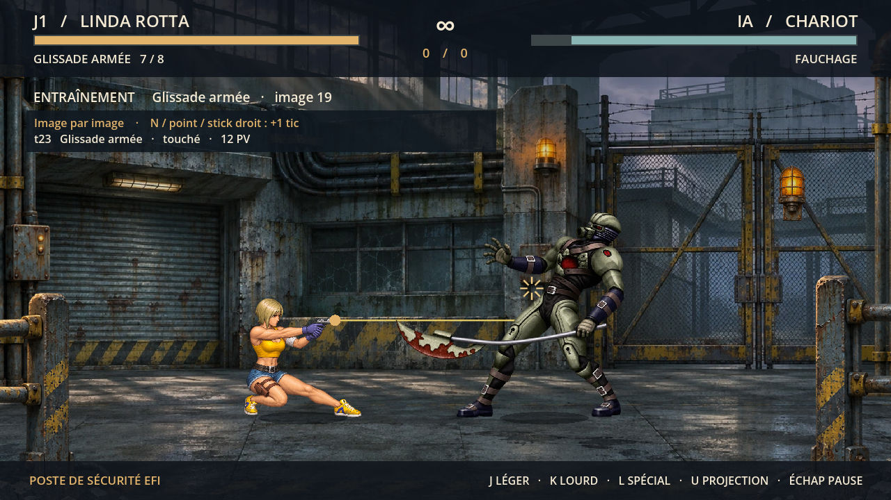
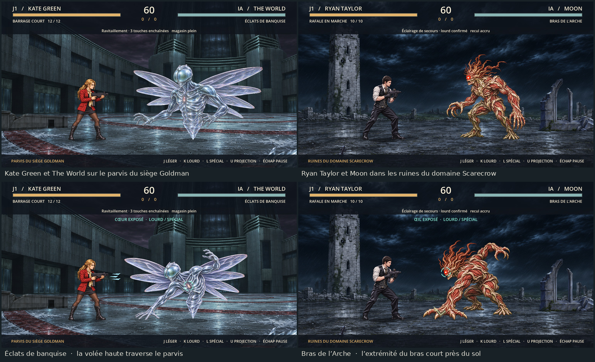
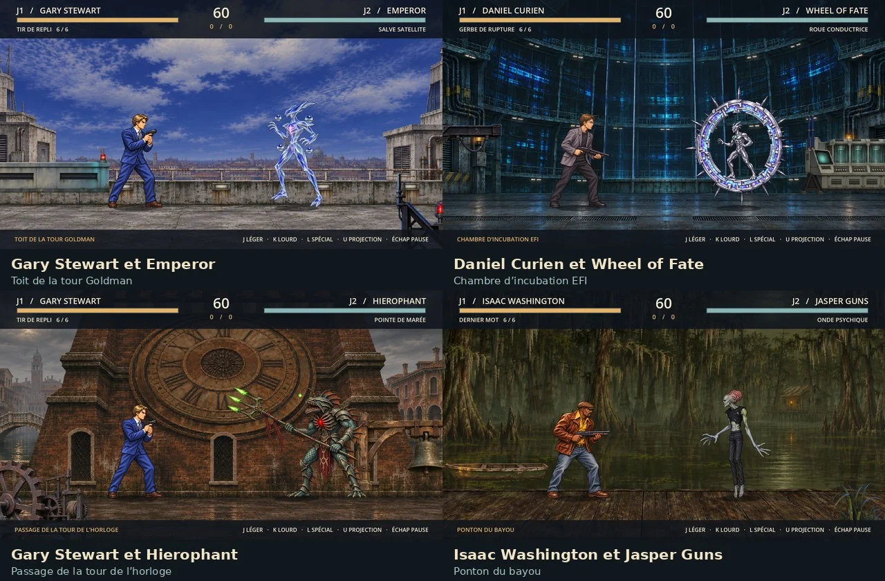

# Jouer à Dossier Curien — Anthologie de combat

Depuis le jeu complet, choisissez **Dossier Curien** dans le menu d’arcade. Dans la version autonome, le menu du mode combat apparaît au démarrage.

## Mise à jour du 19 novembre 2026 — Linda, Zombie Revenge et EX

L’anthologie propose **24 combattants, 26 parcours Histoire, 18 arènes et 29 épreuves d’archives**. Linda Rotta rejoint Stick Breitling et Rikiya Busujima dans le dossier **Zombie Revenge**. Le nouveau **Bestiaire & personnages** regroupe **40 fiches illustrées** de Zombie Revenge et de Loving Deads EX. Le lot comprend **49 PNG individuels** : les 40 illustrations de la galerie et neuf poses supplémentaires de Linda.

### Jouer Linda Rotta

Ouvrez **Chroniques de la saga → Zombie Revenge → Histoire → Linda Rotta**. Son parcours traverse trois exercices : une progression contre Stick, un duel avec Rikiya et un dernier relevé face à Death. Chaque acte possède son texte de mise en scène, puis un épilogue personnel. Les rencontres, les règles du duel et la présence du boss invité sont des adaptations du **simulateur AMS** propres à ce mode de combat.

Pour un duel libre, choisissez **Duel contre IA**, **Duel local**, **Tournoi**, **Entraînement** ou un circuit de **Boss Rush AMS**, puis Linda sur la cinquième page de sélection. Dans le bestiaire, **Zombie Revenge → Linda Rotta → Jouer Linda** ouvre directement le choix de l’adversaire.

Linda utilise un pistolet de **8 cartouches**. **L** déclenche le *Tir de liaison* : un tir haut qui passe au-dessus d’une cible accroupie. **↓ + L**, au sol, déclenche la *Glissade armée* : elle avance de 40 unités en position basse, puis tire à plus courte portée. Cette variante atteint une cible accroupie ; un saut permet de sortir de sa bande de tir. La glissade n’accorde pas d’invincibilité et reste exposée aux projections. Chaque tir consomme une cartouche. **R** recharge tout le magasin en 36 tics, soit 0,6 seconde à 60 Hz.

Sa garde, son anticipation, son tir, sa récupération, sa réaction à un impact et ses deux appuis de marche disposent de fichiers distincts. Trois poses basses complètent ce jeu : **accroupissement**, **garde accroupie** et **tir en glissade**. Elles replient réellement les jambes en conservant l’échelle de la tête, du torse et des mains. La sortie du canon de chaque pose de tir possède son propre repère. La marche alterne encore les deux appuis avec la garde. Les sauts, la projection, le rechargement et la finition utilisent des adaptations des poses disponibles ; le lot ne constitue pas un cycle complet dessiné image par image. Les textes du parcours utilisent les visuels disponibles, sans nouvelles illustrations spécifiques d’introduction ou d’épilogue.

### Consulter le bestiaire

Au menu **Dossier Curien**, ouvrez **Bestiaire & personnages**. Les filtres **Tous**, **Zombie Revenge** et **Loving Deads EX** permettent de parcourir les collections par pages de cinq fiches. Ouvrez un nom pour agrandir son illustration, connaître son rôle et lire l’état de sa référence. Les boutons **Fiche précédente**, **Fiche suivante** et **Retour à la liste** conservent la navigation ; **Échap** revient à la page de la fiche.

Les images de boss, créatures, personnages secondaires et variantes sont des ressources de production consultables. Le bouton **Jouer Linda** est relié au combattant intégré. Les variantes EX illustrées de Zobio et Zobiko ne remplacent pas automatiquement leurs sprites de duel existants. Les fiches signalent les références encore à confirmer ; la présence d’une illustration ne certifie pas une fidélité visuelle 1:1 ni un moveset terminé.

Le [manifeste de l’extension](../../data/assets/dossier_curien_expansion.json) conserve les références, les prompts, les dimensions natives et les empreintes des fichiers. Les poses d’animation de Linda sont enregistrées séparément et n’ajoutent pas de doublons à la galerie.

### Commandes du duel

| Action | Joueur 1 | Joueur 2, duel local | Manette |
| --- | --- | --- | --- |
| Se déplacer | ← / → | Q / D ou A / D | Croix ou stick gauche |
| Sauter | ↑ | Z ou W | Haut de la croix ou du stick |
| Se baisser | ↓ | S | Bas de la croix ou du stick |
| Garder | Maintenir la direction arrière | Maintenir la direction arrière | Maintenir arrière |
| Coup léger | J | F | A |
| Coup lourd | K | G | X |
| Spécial | L | H | B |
| Variante basse, si disponible | ↓ + L | S + H | Bas + B |
| Projection | U | T | Y |
| Recharger | R | E | LB |
| Finition, après le K.-O. décisif | I | Y | RB |
| Pause / retour | Échap | Échap | Start |

Un léger confirmé peut s’enchaîner en lourd, puis un lourd confirmé en spécial. La pause donne accès aux données de chaque coup. Dans **Entraînement → Pause → Atelier technique**, les trois exercices sont disponibles pour chacun des **24 combattants**, soit **72 exercices**. La cadence image par image avance d’un tic avec **N**, la touche **point** ou le **clic du stick droit**.

## Lots précédents du 19 novembre — marches et parallaxe

Cette révision regroupe **50 nouveaux PNG depuis le volume IV**, répartis en deux lots complémentaires :

- **Premier lot, 22 images :** douze poses de combat pour Rogan, G et Magician ; quatre appuis de marche pour Kate et sa tenue de réception ; trois accessoires indépendants à Venise ; les trois plans de la **Rue dévastée de Despair**.
- **Complément, 28 images :** huit appuis pour James, Lisa et Ryan dans ses deux tenues ; seize plans intermédiaires et avant pour les huit arènes qui en manquaient ; deux objets de décor ; le fusil et les lunettes de Lisa en fichiers séparés.

Le mode propose **18 arènes**, dont **15 arènes Saga avec trois plans peints**. Les marches suivent la tenue choisie et utilisent des pivots propres aux nouvelles images pour garder les pieds sur la ligne de sol. Les pièces de Lisa sont disponibles comme sources graphiques séparées ; leur assemblage sur un personnage animé reste à réaliser.

### Découvrir les ajouts

Pour essayer Despair, choisissez **Dossier Curien → Duel local**, puis Kate et un adversaire. La quatrième page des arènes contient **Rue dévastée de Despair**. Les poses de tir et de récupération de Rogan, G et Magician s’utilisent dans les duels du dossier initial.

Pour les nouvelles marches, ouvrez **Entraînement → James Taylor, Lisa Rogan ou Ryan Taylor**, puis une arène comme le poste de sécurité EFI, le métro, le quai de Venise ou la réception Scarecrow. **Tenues de Kate et Ryan** permet d’essayer les appuis de chaque tenue de ces deux personnages. Ces cycles alternent encore deux appuis et la garde ; des phases intermédiaires restent à produire.

[Bilan du premier lot](saga/production/REPRISE_2026-11-19.md) · [Complément, décompte regroupé et limites](saga/production/REPRISE_2026-11-19_PARALLAXE.md) · [Inventaire des manquants](saga/production/MANQUANTS_2026-11-19.json).

### Lancer depuis les sources

Ouvrez `project.godot` dans **Godot 4.7.1**, laissez les ressources s’importer, puis lancez le projet. Depuis la racine du dépôt, la commande équivalente est :

```sh
godot --path .
```

## Assembler le paquet actualisé depuis ce dépôt

Utilisez le dossier [saga/jeu](saga/jeu) de cette révision avec son [fragments.json](saga/jeu/fragments.json) et ses **27 fragments**. Le manifeste est la référence pour les fichiers, leurs tailles et leurs empreintes ; conservez les fragments et le manifeste du même lot. Le paquet de **95 935 632 octets** conserve les ajouts antérieurs de marches et de parallaxe et intègre les 49 PNG de l’expansion. Sa reconstruction a été vérifiée.

Dans ce dossier, utilisez Python 3.8 ou plus récent pour assembler le paquet. Le script vérifie chaque fragment et l’empreinte SHA-256 du jeu complet. Si la version précédente de l’anthologie est déjà assemblée, sa mise à jour est automatique après vérification de son empreinte. Lancez ensuite le paquet avec Godot 4.7.1.

```sh
python3 assembler.py
godot --main-pack HOTD_Anthologie.pck
```

Sous Windows, ouvrez PowerShell dans ce même dossier. Remplacez le chemin de l’exécutable par celui de votre installation Godot.

```powershell
py -3 assembler.py
.\Godot_v4.7.1-stable_win64.exe --main-pack .\HOTD_Anthologie.pck
```

Un paquet `HOTD_Anthologie.pck` déjà téléchargé en un seul fichier se lance directement avec la deuxième commande.

## Dans le navigateur

Depuis une copie complète du dépôt, ouvrez le dossier [saga/jeu](saga/jeu) et lancez les commandes suivantes. Le lanceur ouvre une adresse locale dans votre navigateur. Gardez la fenêtre du lanceur ouverte pendant la partie.

```sh
python3 preparer_web.py
python3 Jouer.py
```

Sous Windows, après `py -3 preparer_web.py`, double-cliquez sur `Jouer-Windows.cmd`. Le ZIP de jeu associé à la bible du volume IV documente cette ancienne livraison.

Le ZIP **HOTD_Anthologie_Linda_EX_2026-11-19_web.zip** contient déjà le dossier `site/` préparé. Après extraction complète, lancez directement **Jouer-Windows.cmd** sous Windows ou **python3 Jouer.py** sous Linux/macOS. Cette archive ne demande ni Godot ni assemblage. Le navigateur doit disposer de WebGL2. Le lanceur Windows peut utiliser PowerShell si Python n’est pas installé ; ce chemin de lancement Windows n’a pas été exécuté dans l’environnement Linux de contrôle.

### État de la vérification visuelle

Le [contrôle visuel de l’expansion](saga/production/expansion_2026-11-19/CAPTURE_PROTOCOL.md) documente le bestiaire, le choix de Linda, son tir debout, ses deux appuis de marche, ses poses basses et son tir en glissade. Le paquet final a été lancé dans Godot 4.7.1 : le tir de glissade part du canon, consomme une cartouche et inflige les 12 PV prévus. La reprise de l’atelier fonctionne sans devoir avancer d’une image supplémentaire.

L’essai web a atteint la page de lancement, puis le Chromium partagé a signalé **WebGL2 indisponible**, y compris après un rechargement. Le jeu n’a donc pas démarré dans ce navigateur. Les fichiers sont fournis et leur identité avec le paquet natif a été vérifiée, mais **la jouabilité web de cette révision reste à confirmer sur un navigateur disposant de WebGL2**. La preuve et les limites figurent dans [VISUAL_QA.json](saga/production/expansion_2026-11-19/VISUAL_QA.json).



Les captures et vidéos des sections suivantes restent celles des volumes III et IV. Une revue complète des transitions et de la fidélité artistique reste nécessaire ; les contrôles de cette livraison portent sur les cas décrits dans le protocole.

## De Pandore à l’Arche • Volume IV

Dans **Chroniques de la saga → The House of the Dead 4 → Histoire**, choisissez **Kate Green** pour retrouver James et affronter The World au parvis de Goldman. Choisissez **The World** pour jouer les trois actes du côté de la créature. Dans **Scarlet Dawn**, Ryan rejoint Kate face à Moon, dans les ruines du domaine Scarecrow. Moon a également son propre parcours en trois combats, avec une introduction, un rival, un dernier duel et un épilogue illustrés.

**The World** fait passer deux salves de glace à hauteur de buste avec L. La première touche ralentit la marche, le second passage oblige à tenir sa défense. Bas + L déclenche sa hache à courte portée. **Moon** propage sa frappe au ras du sol avec L. Sautez lorsque son bras redescend. Bas + L déclenche une attraction à moyenne distance, avec une zone libre près du corps. Dans les finales de Kate et Ryan, le scanner AMS suit le noyau de The World ou l’œil de Moon pendant leurs changements de pose. Après une victoire décisive par K.-O., appuyez sur I pour lancer leur finition si vous jouez le boss.

**Boss Rush AMS → De Pandore à l’Arche** enchaîne Justice, The World et Moon. Une halte entre les adversaires permet de conserver son avantage au chronomètre, de se soigner ou de recharger.

À la sélection du combattant, **Tenues de Kate et Ryan** permet d’essayer les vêtements portés au manoir de Scarlet Dawn. **Entraînement → Pause → Atelier technique** donne accès à trois exercices pour chacun des 24 combattants de la version courante. Activez le journal des impacts pour lire le tic et les dégâts de chaque touche. En mode image par image, une pression sur N, la touche point ou le stick droit avance d’un tic. L’atelier mémorise les exercices réussis par combattant.



[Voir les deux confrontations en mouvement](saga/Duels_World_Moon.mp4)

## Un premier duel dans les épisodes II et III

Ouvrez **Chroniques de la saga → The House of the Dead III → Histoire → Lisa Rogan**. Passez l’introduction pour entrer au poste de sécurité. Le deuxième duel oppose Lisa à Death. En finale, Daniel retrouve Lisa dans la chambre d’incubation face à Wheel of Fate. Dans le dossier de II, James retrouve Emperor sur le toit de Goldman. Le briefing du dernier acte et la pause proposent le scanner de point faible pour ces deux combats.

Les flèches déplacent J1. J donne un coup léger, K un lourd, L le spécial, U une projection et R recharge. Maintenez arrière pour garder. Après une victoire décisive par K.-O., I déclenche la finition. Échap ouvre la pause et donne accès à la liste des coups.

Pour essayer la frappe en pleine manche, ouvrez **Archives et variantes → The Typing of the Dead → Lancer l’épreuve**. Tab ouvre le terminal. Recopiez le mot et validez par Entrée. La touche View et la croix directionnelle en donnent une adaptation pour manette.

Parmi les 29 épreuves figurent **The Typing of the Dead US Edition**, la réédition PC de 2005 et **Typing Lariat** sur Windows. US Edition demande des appels en anglais. La réédition de 2005 accorde une seconde par mot. Lariat prolonge l’ouverture pour tenter une projection.

**Archives et variantes → House of the Dead: Reawakened → Lancer l’épreuve** ouvre *Les trois ouvertures*. Le volet gauche, la porte de face puis le volet droit s’ouvrent à tour de rôle. Pendant que le signal est actif, appuyez sur Tab ou View, ou touchez votre adversaire. Réussir les trois dans l’ordre donne 12 PV de dégâts supplémentaires et interrompt l’adversaire. Une ouverture manquée oblige à recommencer la série.

[Voir les trois ouvertures validées en jeu](saga/Reawakened_en_jeu.webp)

## Boss Rush AMS

Au menu principal, ouvrez **Boss Rush AMS → Les gardiens d’EFI**, puis choisissez votre combattant. Une seule manche contre Death vous sépare de Wheel of Fate. La vie et les cartouches restantes sont conservées entre les deux combats. Une halte permet de récupérer 18 PV pour cinq secondes au classement, ou de remplir le chargeur pour trois secondes. Le meilleur temps est conservé par circuit et combattant sur le même appareil. Le lanceur réutilise le port local 28716 pour retrouver les records dans le même navigateur. Si ce port est occupé, il signale que la nouvelle adresse aura ses propres records. Le circuit Anthologie enchaîne huit gardiens.

**Pour essayer les quatre recrues**, ouvrez Histoire dans le dossier de *II* pour Gary et Emperor, ou dans celui de *III* pour Daniel et Wheel. Au sol, maintenez bas en lançant le spécial d’Emperor ou de Daniel pour obtenir la variante. Gary recule avant le tir et peut donner un coup de coude avec J. L’anneau de Wheel passe à l’aller et au retour.



[Voir Gary et Emperor en mouvement dans le moteur](saga/Echange_Gary_Emperor.mp4)

## Documents

- [Extension Zombie Revenge et EX — ressources, références et état des poses](../../data/assets/dossier_curien_expansion.json)
- [Premier lot du 19 novembre — 22 PNG](saga/production/REPRISE_2026-11-19.md)
- [Complément marches et parallaxe — 28 PNG, livraison regroupée de 50 images](saga/production/REPRISE_2026-11-19_PARALLAXE.md)
- [Manifeste des fragments du paquet actualisé](saga/jeu/fragments.json)
- [Bible intégrale, volumes I à IV, 83 pages](saga/HOTD_Anthologie_Bible_integrale.pdf)
- [Volume IV — De Pandore à l’Arche](saga/HOTD_Bible_IV_De_Pandore_a_l_Arche.pdf) et [texte de production](saga/VOLUME_IV.md)
- [Boss et points faibles](saga/REFERENCES_COMBATTANTS_IV.md), [arènes et parallaxe](saga/SOURCES_ARENES_IV.md) et [tenues et cycles de marche](saga/TENUES_ET_MARCHE_IV.md)
- [Volume III — Les gardiens](saga/HOTD_Bible_III_Les_gardiens.pdf) et [texte de production](saga/VOLUME_III.md)
- [Volume II — Anthologie de combat](saga/HOTD_Anthologie_Bible_Saga.pdf)
- [Volume I — Le dossier du manoir](HOTD_Dossier_Curien_Bible.pdf)
- [Sources des combattants du volume III](saga/VAGUE_III_REFERENCES.md) et [sources des quatre arènes](saga/SOURCES_ARENES_III.md)
- [Registre des ressources peintes de l’anthologie](saga/CATALOGUE_VISUEL_SAGA.json)
- [Sources et périmètre des jeux](saga/SOURCES_ET_CORPUS.md)
- [Paquet historique du seul manoir](Dossier_Curien.pck)
