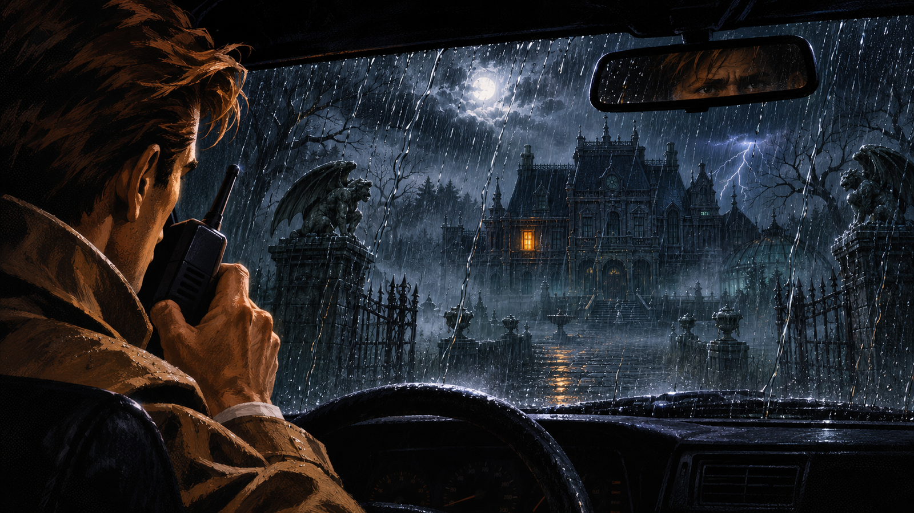
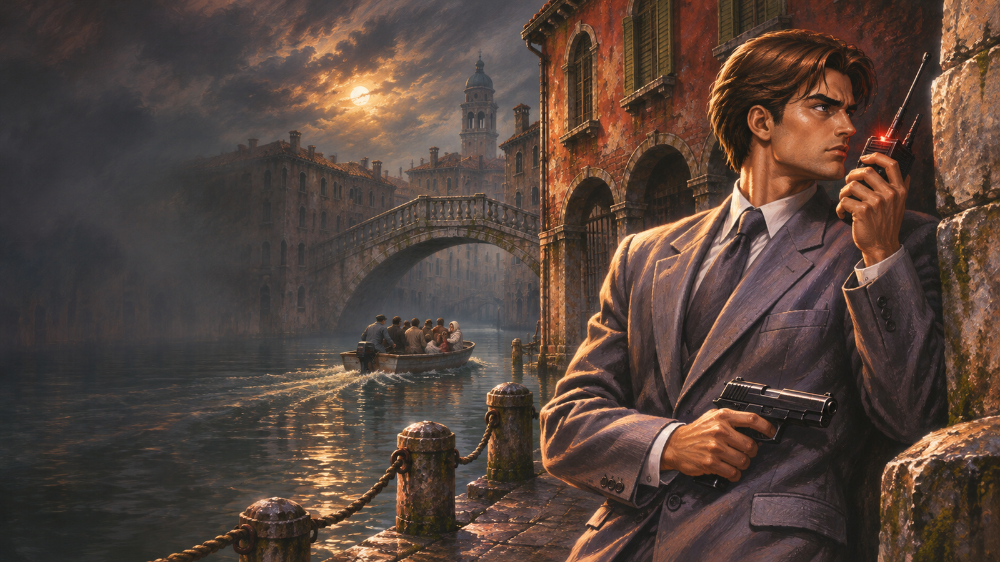
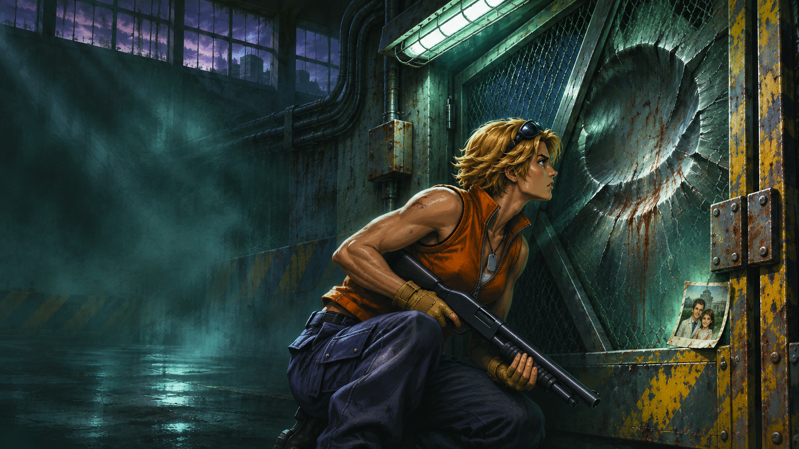
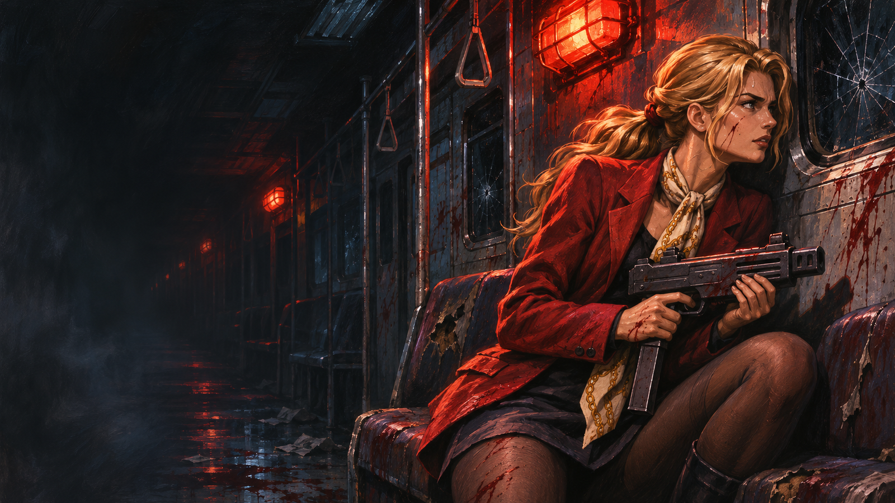
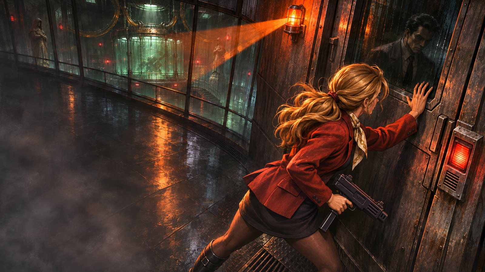
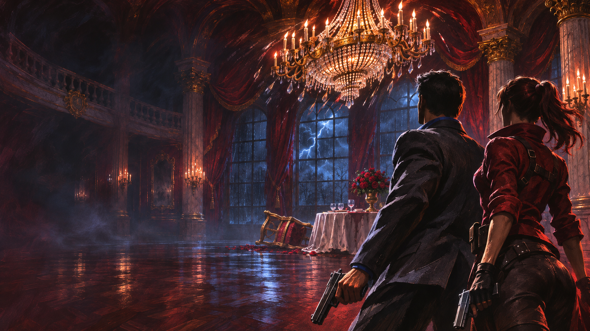
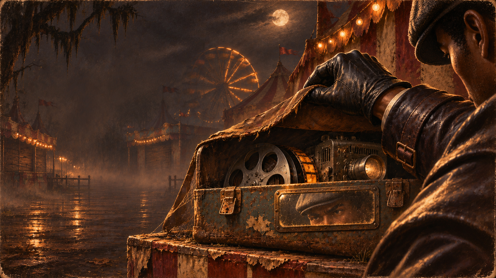
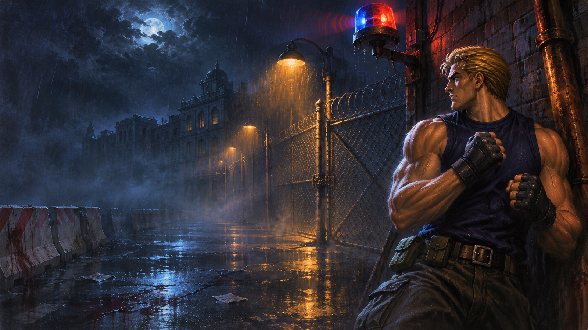
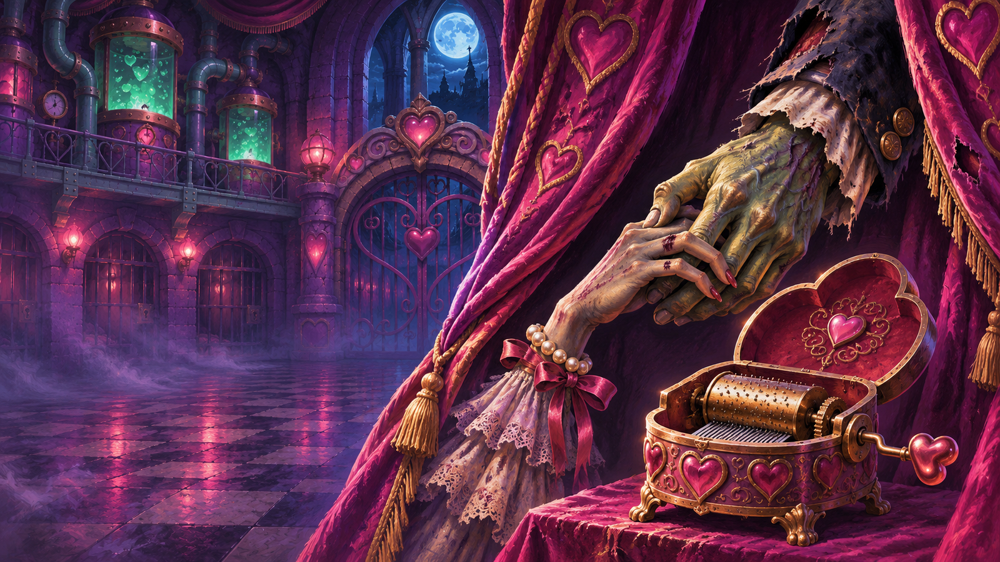

# Dossier Curien — Anthologie de combat

Bible de la saga · volume II · novembre 2026

## Entrer dans l’anthologie

Le menu de Dossier Curien ouvre deux portes vers la série.

| Entrée | Ce que lance le joueur |
| --- | --- |
| Chroniques de la saga | Un dossier précis, une distribution de départ, un terrain et une règle de manche. |
| Archives et variantes | Un défi contre l’IA associé à une édition ou un dérivé. Le descriptif annonce le dispositif utilisé en combat. |
| Duel local / Duel contre IA | Une confrontation libre avec la distribution de l’anthologie. |
| Tournoi | Un tableau à élimination directe. Le vainqueur avance jusqu’au titre. |
| Entraînement | Un partenaire de réglage pour essayer la portée, la garde et les enchaînements. |

### Deux joueurs au même écran

J1 se déplace avec les flèches. J donne un léger, K un lourd, L active la technique, U projette et R recharge. I déclenche la finition après la victoire. J2 peut jouer avec Q/D ou A/D, Z ou W pour sauter, S pour s’accroupir, F/G/H pour attaquer, T pour projeter, E pour recharger et Y pour finir.

À la manette, A donne le léger, X le lourd, B le spécial et Y la projection. LB recharge, RB déclenche la finition et Start met la partie en pause. Les épreuves à terminal acceptent aussi la croix directionnelle.

Commencer par Chroniques de la saga → The House of the Dead III → Histoire. Lisa affronte Death au deuxième acte. Sa recharge et le temps de récupération de la massue permettent de lire immédiatement le duel.

## Du tir sur rail au face-à-face

Le duel dure deux manches gagnantes. La simulation tourne à 60 tics par seconde.

### Portée, garde et confirmation

Le jeu oriente les combattants vers le rival au neutre. Maintenir la direction opposée garde au sol. La projection ouvre la garde. Certains tirs rectilignes passent au-dessus d’une cible accroupie. La portée est résolue dans l’axe du combattant, avec une tolérance de hauteur propre au coup.

Un léger qui touche peut être interrompu par un lourd. Un lourd confirmé autorise le spécial. Le moteur garde une entrée en mémoire pendant cinq tics. Un coup bloqué ne valide pas cette chaîne. Les duels croisés utilisent le même ordre de résolution des impacts.

### Un exemple de décision

James peut chercher deux impacts à mi-distance. Lisa doit se rapprocher pour sa gerbe, puis choisir combien de cartouches recharger. Un joueur qui recule contre Zobio bloque ses coups ordinaires et s’expose à son étreinte.

### Finitions

La victoire du match ouvre un bref état de finition. J1 appuie sur I, J2 sur Y, ou le gagnant utilise RB. La séquence porte le nom de sa fiche et résout la rencontre. L’expiration du délai permet de poursuivre le tableau ou le récit.

Les distances et délais publiés dans les fiches suivantes sont les valeurs de cette adaptation. Les attaques originales des rail shooters servent de références visuelles et de rythme.

## Le tournoi et le laboratoire

Le tournoi tire trois adversaires dans la distribution disponible. Le laboratoire permet de reproduire un échange autant de fois que nécessaire.

### Un tableau de quatre

Le joueur occupe la première demi-finale. Le moteur joue la seconde avec les mêmes personnages, portées, munitions, gardes et règles de touche que dans un duel. Le tableau affiche ensuite le nom du finaliste. Gagner la demi-finale puis la finale remporte le tournoi.

### Tester une ouverture

Dans Entraînement, la pause permet de placer le mannequin en garde ou de le laisser immobile, d’ouvrir la liste de coups de J1 et de remettre les deux personnages au centre de leur configuration initiale. La barre de vie du mannequin revient après un K.-O.

| Séquence à essayer | Observation attendue |
| --- | --- |
| Ouvrir la garde | À distance de projection, passer du léger bloqué à la projection et surveiller la confirmation. |
| Punir Death | Reculer devant la massue, puis avancer pendant la récupération. Comparer la portée du léger et du lourd de Lisa. |
| Interrompre un tir | S’accroupir au passage du tir de James. Vérifier si la même défense couvre la gerbe de Lisa. |
| Rouvrir le terminal | Dans Typing, ouvrir avec Tab, saisir le mot et presser Entrée. Une confirmation correcte produit un impact et une ouverture. |

### Victoire

Les duels ordinaires démarrent à 60 secondes et le dossier 4 Special à 35 secondes. Une manche à égalité est rejouée. Une victoire par K.-O. décisif ouvre la fenêtre de finition pendant 150 tics. La séquence de finition dure ensuite 72 tics. Une victoire au temps mène directement au résultat.

## Neuf affaires jouables

Chaque ligne indique la tête d’affiche proposée dans le dossier et son arène de référence.

| Jeu source | Tête d’affiche | Arène |
| --- | --- | --- |
| The House of the Dead | Thomas Rogan | Cour du manoir |
| The House of the Dead 2 | James Taylor | Quai de la cité inondée |
| The House of the Dead III | Lisa Rogan | Poste de sécurité EFI |
| The House of the Dead 4 | Kate Green | Métro souterrain |
| The House of the Dead 4 Special | Kate Green | Complexe déserté |
| House of the Dead Scarlet Dawn | Ryan Taylor | Réception de Scarecrow Mansion |
| The House of the Dead OVERKILL | Isaac Washington | Fête foraine de Bayou City |
| Zombie Revenge | Stick Breitling | Rue en quarantaine |
| Loving Deads • The House of the Dead EX | Zobio | Plateau de Loving Deads |

### Comment lire une histoire

Une introduction place le héros dans le décor. Le deuxième combat isole un rival et le dernier ouvre la fin du parcours. Les duels interséries sont écrits comme des reconstitutions AMS ou des exhibitions. Un adversaire venu d’une autre chronologie peut donc figurer sur la même bande sans modifier l’issue du jeu d’origine.

## The House of the Dead

Thomas Rogan et G répondent à l’appel de Sophie au manoir Curien. La cour et la verrière gardent les traces du passage des chercheurs.

### Les trois actes

| Séquence | Scène écrite pour le mode |
| --- | --- |
| Introduction | L’appel de Sophie conduit Rogan et G jusqu’au portail du manoir. |
| Rival | Chariot attend sous la verrière. L’armure occupe la voie de sortie de la pièce. |
| Ending | Après Magician, Rogan réécoute l’appel et conserve l’heure inscrite sur son papier. |

### Règle et mise en scène

Duels du manoir. Deux manches gagnantes de 60 secondes.

Faire lire la portée de la bardiche à travers le reflet dans la verrière. Garder la grille de la cour dans la pénombre pour détacher le pardessus de Rogan.

Parcours principal   /   Agent G   →   Chariot   →   Magician

## The House of the Dead 2

James Taylor enquête dans une ville de canaux. Les civils et les passages d’une rive à l’autre donnent son échelle au drame. Hierophant apporte son trident et ses branchies thoraciques au duel.

### Les trois actes

| Séquence | Scène écrite pour le mode |
| --- | --- |
| Introduction | James reçoit une transmission hachée au bord du canal. L’AMS rejoue le passage à quai pour établir à quel moment les derniers civils ont pu rejoindre la rive. |
| Rival | Hierophant surgit à l’aplomb de l’eau. La pointe du trident reste hors de portée jusqu’au moment où son porteur avance sur les dalles. |
| Ending | La radio retrouve un canal libre. James inscrit le lieu du dernier appel sur sa carte et transmet les coordonnées des rescapés. |

### Règle et mise en scène

Secours sur le quai. Un enchaînement de trois touches rend trois secondes, une fois par joueur et par manche.

Le parapet fixe la ligne d’appui. Le trident doit se distinguer de la rambarde, même quand le côté du joueur est inversé.

Parcours principal   /   Agent G   →   Hierophant   →   Magician

## The House of the Dead III

Lisa Rogan et G entrent dans le complexe EFI à la recherche de Thomas. Death, le gardien en uniforme à la massue ornée de crânes, donne au poste de sécurité un adversaire à sa mesure.

### Les trois actes

| Séquence | Scène écrite pour le mode |
| --- | --- |
| Introduction | Lisa et G poussent les portes du centre EFI sur les traces de Thomas. Une tôle froissée conserve la marque ronde d’une massue. |
| Rival | Death remplit l’encadrement de la porte de sécurité. Lisa profite du temps que prend la massue pour remonter après son passage. |
| Ending | G rejoint Lisa près de la sortie. Elle remet la photo de son père dans sa poche pendant que le portail s’ouvre sur la lumière grise. |

### Règle et mise en scène

Relève. Une projection réussie restitue six points de vie à son auteur, une seule fois par manche.

La recharge de Lisa se fait cartouche par cartouche. La dernière touche d’une projection offre à Lisa le temps de décider si elle recharge ou reste au contact.

Parcours principal   /   Agent G   →   Death   →   Thomas Rogan

## The House of the Dead 4

James et Kate sont bloqués dans les installations de l’AMS. La rafale et le danger à très courte portée distinguent le quatrième épisode. Justice conserve sa silhouette massive à quatre bras.

### Les trois actes

| Séquence | Scène écrite pour le mode |
| --- | --- |
| Introduction | À la lueur des blocs de secours, Kate retrouve James entre deux rames immobiles. Une sirène annonce la fermeture des portes. |
| Rival | Entre deux rames, Justice ouvre ses quatre bras et bloque la sortie. Kate le force à se retourner près de la bande de sécurité. |
| Ending | La rame reste à quai. Kate marque l’escalier encore praticable et reprend la montée pendant que les lampes de secours s’éteignent une à une. |

### Règle et mise en scène

Fenêtre de ravitaillement. La première série de trois touches recharge le magasin du combattant qui l’a réussie.

La rame éclaire les quatre mains de Justice. Sous son allonge, Kate peut alterner pression et repli, mais chaque rafale dépense plusieurs munitions.

Parcours principal   /   James Taylor   →   Justice   →   Magician

## The House of the Dead 4 Special

L’attraction d’arcade prolonge le quatrième épisode avec Kate et G. La borne orientait les passagers vers l’action. Le compte à rebours resserre ici la confrontation.

### Les trois actes

| Séquence | Scène écrite pour le mode |
| --- | --- |
| Introduction | G rejoint Kate sur la piste d’une nouvelle menace. Le bruit d’un générateur couvre la radio quand ils pénètrent dans le complexe. |
| Rival | Le compte à rebours repart. Entre deux portes blindées, le simulateur restitue un exercice de couverture avec James. |
| Ending | Kate et G quittent la chambre avant la fermeture des cloisons. L’AMS conserve la bande du compte à rebours pour sa prochaine équipe. |

### Règle et mise en scène

Compte à rebours. Une manche dure 35 secondes. Chaque première attaque spéciale confirmée accorde cinq secondes.

Le balayage lumineux suggère la rotation de la cabine. Les joueurs gardent une lecture latérale stable pendant le duel.

Parcours principal   /   Agent G   →   James Taylor   →   Magician

## House of the Dead Scarlet Dawn

Ryan Taylor rejoint Kate Green à Scarecrow Mansion. La réception mondaine interrompue et le retour de créatures familières donnent leur identité à l’arène.

### Les trois actes

| Séquence | Scène écrite pour le mode |
| --- | --- |
| Introduction | Ryan et Kate se séparent dans la réception du manoir. Les reflets rouges des appliques bougent sur les portes pendant que les invités cherchent une sortie. |
| Rival | Dans la reconstitution, le reflet de James se place entre Ryan et le grand escalier. Ryan doit couvrir l’évacuation sans céder son côté de la salle. |
| Ending | Un dernier verre roule sous les tables. Ryan retrouve Kate au pied des marches et lui transmet son relevé des portes ouvertes. |

### Règle et mise en scène

Éclairage de secours. Un coup lourd confirmé repousse l’adversaire de 60 unités supplémentaires, une fois par manche.

L’éclat des lustres reste dans le haut du cadre. Le rouge des rideaux encadre les acteurs et le dallage froid permet de lire les pieds.

Parcours principal   /   Kate Green   →   James Taylor   →   Chariot

## The House of the Dead OVERKILL

G et Isaac Washington traversent Bayou City. La série adopte la texture d’une pellicule d’exploitation et nomme ses adversaires des mutants. La fête foraine fournit le décor de l’anthologie.

### Les trois actes

| Séquence | Scène écrite pour le mode |
| --- | --- |
| Introduction | À Bayou City, Washington retrouve G sous les ampoules d’un manège arrêté. La bobine du projecteur claque contre le métal de sa boîte. |
| Rival | La pellicule saute. Dans cette bobine reconstituée, Jasper Guns déforme les enseignes de la foire sans les toucher. Washington reconnaît sa silhouette avant son visage. |
| Ending | Isaac arrache le ticket de la dernière séance. G l’attend près du grillage pendant que la musique du manège ralentit. |

### Règle et mise en scène

Prise continue. Un premier enchaînement de trois touches rend huit points de vie à son auteur.

Le grave de Washington et l’occupation de l’espace par Jasper appellent des distances différentes. Réserver le grain marqué aux plans narratifs pour garder les impacts lisibles.

Parcours principal   /   Agent G   →   Jasper Guns   →   Zobio

## Zombie Revenge

Le beat’em up fait du contact physique la première ressource du joueur. Stick Breitling, Linda Rotta et Rikiya Busujima appartiennent à sa distribution originale.

### Les trois actes

| Séquence | Scène écrite pour le mode |
| --- | --- |
| Introduction | Stick Breitling revient dans la rue bouclée. Le bitume porte encore les traces de la dernière évacuation et un néon grésille au-dessus du trottoir. |
| Rival | Rikiya Busujima se tient de l’autre côté du barrage. La simulation fait rejouer aux deux partenaires un duel d’entraînement au milieu de la rue. |
| Ending | Stick repousse du pied la grille abandonnée. Les agents peuvent traverser le carrefour. Il suit le gyrophare jusqu’au prochain barrage. |

### Règle et mise en scène

Combat de rue. Un premier enchaînement de trois touches prolonge la manche de cinq secondes.

La ligne jaune du trottoir matérialise la portée courte de Stick. La grille au premier plan entre et sort du regard par la parallaxe.

Parcours principal   /   Isaac Washington   →   Rikiya Busujima   →   Death

## Loving Deads • The House of the Dead EX

Le jeu d’arcade suit la fuite amoureuse de Zobio et Zobiko dans une succession d’épreuves. Le plateau conserve les cœurs lumineux et un ton de jeu télévisé.

### Les trois actes

| Séquence | Scène écrite pour le mode |
| --- | --- |
| Introduction | Zobio rejoint le plateau pour un jeu organisé à l’intention de Zobiko. Une rangée d’ampoules s’allume au bord de la piste. |
| Rival | La cloche retentit. Zobiko a pris le centre du plateau pour leur exhibition à deux. Zobio doit la suivre du regard lorsqu’elle quitte le sol. |
| Ending | Zobiko attend Zobio derrière le décor. Ils quittent le plateau ensemble avant que les machineries n’abaissent le rideau. |

### Règle et mise en scène

Coup de cœur. Une première projection réussie rend dix points de vie à son auteur.

L’étreinte de Zobio et les bonds de Zobiko donnent à chacun un rôle distinct. Une touche rose doit conserver son contraste avec la peau bleu-vert des personnages.

Parcours principal   /   Stick Breitling   →   Zobiko   →   Chariot

## Combattants 01 à 05

Les délais indiquent le premier tic actif et le tic de retour au neutre. Les portées sont exprimées dans le repère de jeu de 1 280 pixels.

| Nom | Spécial | Tics | Portée | PV¹ | Réserve |
| --- | --- | --- | --- | --- | --- |
| Thomas Rogan | Tir AMS | 12 / 38 | 700 | 10 | 6 |
| Agent G | Tir réflexe | 8 / 32 | 530 | 8 | 6 |
| Chariot | Fauchage | 22 / 53 | 245 | 23 | 0 |
| Magician | Orbe thermique | 20 / 48 | 760 | 15 | 0 |
| James Taylor | Double détente | 10 / 38 | 610 | 7 | 6 |

¹ Dégâts de base par impact confirmé. Les techniques à plusieurs touches dépendent du nombre d’impacts qui atteignent la cible.

### Finitions et déplacements

| Combattant | Finition | Vitesse² |
| --- | --- | --- |
| Thomas Rogan | Sceau AMS | 5,1 |
| Agent G | Extinction des feux | 5,8 |
| Chariot | Sentence de fer | 3,9 |
| Magician | Combustion | 5,4 |
| James Taylor | Dernier signal | 5,45 |

² Déplacement horizontal au sol en pixels par tic. La vitesse en recul gardé est réduite.

### Lecture du match

Thomas Rogan — Le tir passe au-dessus d’une cible accroupie.

Agent G — Sortie rapide. Le tir se baisse et dépense une cartouche.

Chariot — Grand arc de fauchage. La longue récupération expose Chariot.

Magician — Orbe à longue portée, après un amorçage visible.

James Taylor — Deux tirs espacés de cinq images. Chaque pression dépense deux cartouches.

## Combattants 06 à 10

Les délais indiquent le premier tic actif et le tic de retour au neutre. Les portées sont exprimées dans le repère de jeu de 1 280 pixels.

| Nom | Spécial | Tics | Portée | PV¹ | Réserve |
| --- | --- | --- | --- | --- | --- |
| Lisa Rogan | Gerbe de plomb | 13 / 42 | 345 | 19 | 6 |
| Kate Green | Barrage court | 9 / 36 | 515 | 5 | 12 |
| Ryan Taylor | Rafale en marche | 13 / 45 | 535 | 6 | 10 |
| Isaac Washington | Dernier mot | 16 / 42 | 490 | 14 | 6 |
| Zobio | Étreinte rebond | 11 / 38 | 128 | 19 | 0 |

¹ Dégâts de base par impact confirmé. Les techniques à plusieurs touches dépendent du nombre d’impacts qui atteignent la cible.

### Finitions et déplacements

| Combattant | Finition | Vitesse² |
| --- | --- | --- |
| Lisa Rogan | Sortie de secours | 5,0 |
| Kate Green | Ligne de fuite | 5,9 |
| Ryan Taylor | Aube écarlate | 5,15 |
| Isaac Washington | Rideau de drive-in | 5,4 |
| Zobio | Coup de foudre | 4,65 |

² Déplacement horizontal au sol en pixels par tic. La vitesse en recul gardé est réduite.

### Lecture du match

Lisa Rogan — La gerbe couvre les sauts bas. La recharge insère une cartouche à la fois.

Kate Green — Trois impacts espacés de cinq images. Une rafale consomme trois cartouches.

Ryan Taylor — Ryan avance pendant l’amorce et lâche trois tirs. La rafale consomme trois cartouches.

Isaac Washington — Le coup de revolver repousse fortement la cible. Isaac retrouve sa garde après le recul.

Zobio — Zobio ouvre la garde avec son étreinte. Elle touche uniquement un adversaire au sol.

## Combattants 11 à 15

Les délais indiquent le premier tic actif et le tic de retour au neutre. Les portées sont exprimées dans le repère de jeu de 1 280 pixels.

| Nom | Spécial | Tics | Portée | PV¹ | Réserve |
| --- | --- | --- | --- | --- | --- |
| Stick Breitling | Uppercut de rue | 9 / 38 | 144 | 18 | 0 |
| Hierophant | Pointe de marée | 17 / 43 | 315 | 17 | 0 |
| Death | Coup de massue | 26 / 60 | 228 | 26 | 0 |
| Justice | Étau à quatre bras | 19 / 51 | 166 | 22 | 0 |
| Jasper Guns | Onde psychique | 22 / 52 | 450 | 15 | 0 |

¹ Dégâts de base par impact confirmé. Les techniques à plusieurs touches dépendent du nombre d’impacts qui atteignent la cible.

### Finitions et déplacements

| Combattant | Finition | Vitesse² |
| --- | --- | --- |
| Stick Breitling | Dernier round | 6,2 |
| Hierophant | Marée noire | 4,1 |
| Death | Porte condamnée | 3,65 |
| Justice | Quais condamnés | 3,85 |
| Jasper Guns | Dernière bobine | 4,0 |

² Déplacement horizontal au sol en pixels par tic. La vitesse en recul gardé est réduite.

### Lecture du match

Stick Breitling — L’uppercut atteint une cible en l’air. Stick dispose d’un léger rapide et d’un lourd court.

Hierophant — Le trident allonge la portée du léger et du spécial. Gardez l’agent au bout de la pointe.

Death — L’impact de la massue inflige un fort recul. Son amorce est la plus lente de la sélection.

Justice — La prise à quatre bras ouvre la garde au sol. Le lourd et la projection de Justice privilégient la portée.

Jasper Guns — L’onde psychique attire la cible au lieu de la repousser. Son amorce laisse le temps de se rapprocher.

## Combattants 16 à 17

Les délais indiquent le premier tic actif et le tic de retour au neutre. Les portées sont exprimées dans le repère de jeu de 1 280 pixels.

| Nom | Spécial | Tics | Portée | PV¹ | Réserve |
| --- | --- | --- | --- | --- | --- |
| Zobiko | Bond du cœur | 12 / 37 | 157 | 15 | 0 |
| Rikiya Busujima | Paume de rupture | 15 / 41 | 168 | 17 | 0 |

¹ Dégâts de base par impact confirmé. Les techniques à plusieurs touches dépendent du nombre d’impacts qui atteignent la cible.

### Finitions et déplacements

| Combattant | Finition | Vitesse² |
| --- | --- | --- |
| Zobiko | Rappel en duo | 6,3 |
| Rikiya Busujima | Dernière frappe | 5,65 |

² Déplacement horizontal au sol en pixels par tic. La vitesse en recul gardé est réduite.

### Lecture du match

Zobiko — Zobiko quitte le sol au début de son spécial. Le bond échappe aux projections au sol et atteint les sauts bas.

Rikiya Busujima — Une paume sur la garde inflige trois points de pression sans pouvoir conclure le duel. Le contact libre repousse la cible.

## Les coups au sol · I

Chaque cellule indique le premier tic actif, la fin du mouvement, la portée en pixels et les dégâts sur une touche.

| Combattant | Léger | Lourd | Projection |
| --- | --- | --- | --- |
| Thomas Rogan | 5 / 17 / 125 / 7 | 12 / 34 / 165 / 14 | 7 / 39 / 94 / 16 |
| Agent G | 5 / 17 / 125 / 7 | 12 / 34 / 165 / 14 | 7 / 39 / 94 / 16 |
| Chariot | 5 / 17 / 125 / 7 | 12 / 34 / 165 / 14 | 7 / 39 / 94 / 16 |
| Magician | 5 / 17 / 125 / 7 | 12 / 34 / 165 / 14 | 7 / 39 / 94 / 16 |
| James Taylor | 4 / 15 / 111 / 6 | 12 / 34 / 165 / 14 | 7 / 39 / 94 / 16 |
| Lisa Rogan | 5 / 17 / 125 / 7 | 12 / 34 / 165 / 14 | 7 / 39 / 94 / 16 |
| Kate Green | 4 / 15 / 111 / 6 | 12 / 34 / 165 / 14 | 7 / 39 / 94 / 16 |
| Ryan Taylor | 5 / 17 / 125 / 7 | 12 / 34 / 165 / 14 | 7 / 39 / 94 / 16 |
| Isaac Washington | 5 / 17 / 125 / 7 | 10 / 31 / 143 / 15 | 7 / 39 / 94 / 16 |

### Interpréter une ligne

Un léger annoncé à 5 / 17 / 125 / 7 commence à toucher au tic 5, se termine au tic 17, porte à 125 pixels et retire 7 PV sur impact libre. Les fenêtres actives ordinaires durent trois tics. Une cible en garde et une cible hors de portée demandent deux réponses différentes.

Vérification en jeu  /  Pause → Liste des coups. Le haut du HUD affiche la réserve des combattants armés. Pour tester les coups au sol, veillez à ce que les deux personnages soient sur la même ligne.

## Les coups au sol · II

Chaque cellule indique le premier tic actif, la fin du mouvement, la portée en pixels et les dégâts sur une touche.

| Combattant | Léger | Lourd | Projection |
| --- | --- | --- | --- |
| Zobio | 5 / 17 / 125 / 7 | 12 / 34 / 165 / 14 | 6 / 36 / 112 / 18 |
| Stick Breitling | 4 / 15 / 111 / 6 | 10 / 31 / 143 / 15 | 7 / 39 / 94 / 16 |
| Hierophant | 8 / 24 / 179 / 9 | 12 / 34 / 165 / 14 | 7 / 39 / 94 / 16 |
| Death | 5 / 17 / 125 / 7 | 18 / 46 / 191 / 20 | 7 / 39 / 94 / 16 |
| Justice | 5 / 17 / 125 / 7 | 18 / 46 / 191 / 20 | 6 / 36 / 112 / 18 |
| Jasper Guns | 5 / 17 / 125 / 7 | 12 / 34 / 165 / 14 | 7 / 39 / 94 / 16 |
| Zobiko | 4 / 15 / 111 / 6 | 12 / 34 / 165 / 14 | 7 / 39 / 94 / 16 |
| Rikiya Busujima | 4 / 15 / 111 / 6 | 10 / 31 / 143 / 15 | 7 / 39 / 94 / 16 |

### Interpréter une ligne

Un léger annoncé à 5 / 17 / 125 / 7 commence à toucher au tic 5, se termine au tic 17, porte à 125 pixels et retire 7 PV sur impact libre. Les fenêtres actives ordinaires durent trois tics. Une cible en garde et une cible hors de portée demandent deux réponses différentes.

Vérification en jeu  /  Pause → Liste des coups. Le haut du HUD affiche la réserve des combattants armés. Pour tester les coups au sol, veillez à ce que les deux personnages soient sur la même ligne.

## Épreuves 01 à 05

Choisir Archives et variantes, sélectionner le titre puis Lancer l’épreuve.

### The Typing of the Dead

Saisir les appels de la radio du canal. Un mot complet interrompt l’adversaire.

Terrain de départ   /   Quai de la cité inondée

### The Typing of the Dead 2

Saisir le vocabulaire du centre EFI. Une confirmation rend aussi une cartouche à Lisa.

Terrain de départ   /   Poste de sécurité EFI

### The Typing of the Dead: Overkill

Remonter la bobine mot à mot. Les termes sont ceux d’un tournage à Bayou City.

Terrain de départ   /   Fête foraine de Bayou City

### English of the Dead

Lire le mot français et saisir sa traduction anglaise. Une réponse correcte étourdit le rival.

Terrain de départ   /   Quai de la cité inondée

### Zombie Da: Flick of the Dead

Reproduire trois directions successives avec les flèches ou la croix. La dernière libère une onde.

Terrain de départ   /   Quai de la cité inondée

La règle affichée s’applique à chaque manche. La touche Échap et le bouton Start permettent de retrouver la pause. Les épreuves de visée et de rouleaux fonctionnent avec un rythme déterministe, sans mise.

## Épreuves 06 à 10

Choisir Archives et variantes, sélectionner le titre puis Lancer l’épreuve.

### K-Typing of the Dead

Saisir des mots courts sur le terminal de poche. Les mots reprennent le format bref de l’écran.

Terrain de départ   /   Quai de la cité inondée

### The Pinball of the Dead

Suivre la bille sur le mini-plateau. Près du bas, Tab ou View actionne le batteur. Le troisième retour frappe le rival.

Terrain de départ   /   Quai de la cité inondée

### Darts of the Dead

Une cible balaie la réglette. Tab ou View lance une fléchette. Viser la bande centrale pour toucher.

Terrain de départ   /   Cour du manoir

### The Site of the Dead

Élever un spécimen en duel. Un coup léger, un lourd et une projection confirmés le font évoluer et rendent de la vie.

Terrain de départ   /   Cour du manoir

### The House of the Dead Mobile

Gérer la batterie du terminal. Une attaque spéciale confirmée la vide, une parade tenue la recharge.

Terrain de départ   /   Cour du manoir

La règle affichée s’applique à chaque manche. La touche Échap et le bouton Start permettent de retrouver la pause. Les épreuves de visée et de rouleaux fonctionnent avec un rythme déterministe, sans mise.

## Épreuves 11 à 15

Choisir Archives et variantes, sélectionner le titre puis Lancer l’épreuve.

### The House of the Dead: Nightmare

Traverser le secteur signalé au sol. Trois passages alternés donnent une ouverture sur le rival.

Terrain de départ   /   Cour du manoir

### Overkill – Extended Cut

Monter une prise complète. Confirmer un léger, un lourd puis un spécial dans cet ordre, sur autant d’échanges que nécessaire.

Terrain de départ   /   Fête foraine de Bayou City

### Overkill – The Lost Reels

Retrouver trois fragments de bobine en passant d’un repère latéral à l’autre.

Terrain de départ   /   Fête foraine de Bayou City

### The House of the Dead 2 & 3 Return

Rejouer la sélection Wii sous forme de relais. Les manches alternent entre le canal du II et le poste de sécurité du III.

Terrain de départ   /   Quai de la cité inondée

### The House of the Dead: Remake

Remplir une fenêtre de secours de six secondes. Confirmer un lourd ou un spécial pendant le signal rend six points de vie.

Terrain de départ   /   Cour du manoir

La règle affichée s’applique à chaque manche. La touche Échap et le bouton Start permettent de retrouver la pause. Les épreuves de visée et de rouleaux fonctionnent avec un rythme déterministe, sans mise.

## Épreuves 16 à 20

Choisir Archives et variantes, sélectionner le titre puis Lancer l’épreuve.

### The House of the Dead 2: Remake

L’appel du quai revient par intermittence. Un lourd ou un spécial confirmé pendant l’appel ajoute du temps à la manche.

Terrain de départ   /   Quai de la cité inondée

### Scarlet Dawn – The Attraction

Rejoindre trois postes lumineux tirés de la salle collective. Les postes s’activent en alternance.

Terrain de départ   /   Réception de Scarecrow Mansion

### Scarlet Dawn – Battle Genesis

Réaliser la combinaison légère, lourde, spéciale. Les trois symboles complétés déclenchent un impact.

Terrain de départ   /   Réception de Scarecrow Mansion

### Scarlet Dawn on Reels

Arrêter trois bandes lumineuses sur le centre. Tab ou View verrouille la bande active. Trois verrous réussis déclenchent un impact.

Terrain de départ   /   Réception de Scarecrow Mansion

### The Typing of the Dead: Zombie Panic

Transcrire les messages d’alerte dans une réserve de mots propre à cette édition.

Terrain de départ   /   Quai de la cité inondée

La règle affichée s’applique à chaque manche. La touche Échap et le bouton Start permettent de retrouver la pause. Les épreuves de visée et de rouleaux fonctionnent avec un rythme déterministe, sans mise.

## Épreuves 21 à 25

Choisir Archives et variantes, sélectionner le titre puis Lancer l’épreuve.

### The Typing of the Dead Online

Rejouer en solo une série de transmission. Les mots appartiennent au lexique des communications.

Terrain de départ   /   Quai de la cité inondée

### The Typing of the Dead 2003

Réviser une série autour de la ville inondée. Chaque saisie correcte facilite le prochain échange.

Terrain de départ   /   Quai de la cité inondée

### The Typing of the Dead 2004

Série de saisie consacrée aux lieux de passage de l’enquête.

Terrain de départ   /   Quai de la cité inondée

### The Typing of the Dead featuring Rakuten

Saisir le lexique du bureau. Une transmission correcte déclenche une ouverture.

Terrain de départ   /   Quai de la cité inondée

### Zombie Da: Typing Lariat for Mac

Épreuve de frappe réservée aux mots du corps-à-corps, dans la simulation du canal.

Terrain de départ   /   Quai de la cité inondée

La règle affichée s’applique à chaque manche. La touche Échap et le bouton Start permettent de retrouver la pause. Les épreuves de visée et de rouleaux fonctionnent avec un rythme déterministe, sans mise.

## Trois distances de lecture

Le décor situe l’épisode avant que le joueur ait lu le nom de l’arène.

### Au fond, le lieu

Le canal, le poste EFI, le métro, le complexe de Special, la réception, la fête foraine, le plateau EX et la rue de Zombie Revenge utilisent chacun une peinture 16:9. La cour du manoir conserve ses trois calques peints d’origine.

### Au milieu, la distance

Sur les huit nouveaux terrains, le moteur ajoute les éléments intermédiaires et de premier plan. Le déplacement relatif suit le centre des deux combattants. Les pieds restent sur la même ligne. Un joueur peut ainsi estimer sa portée malgré le mouvement du décor.

### Au premier plan, la silhouette

Le pivot se place sur la ligne de sol. Le combattant inverse son orientation autour de cet appui. Les sprites ont un alpha transparent. Une garde, un contact et tout futur mouvement gardent des fichiers séparés pour pouvoir corriger une pose sans redessiner les autres.

### Contrôles de fidélité

Vérifier les deux orientations au même point du terrain, le nombre de mains de Justice, la tête du trident, le volume de la massue et l’arme de Kate. Contrôler chaque pose claire sur les deux fonds les plus sombres et chaque pose sombre dans la lumière de la réception.

La fidélité visée concerne les silhouettes, tenues, accessoires, lieux et signes distinctifs de chaque épisode. Les illustrations sont originales. Une validation image par image contre les modèles de chaque édition reste un travail de production.

## Compléter la distribution

Ces cibles de production prolongent les dossiers livrés. Elles indiquent où une extension modifierait réellement le combat.

| Dossier | Personnages ou gardiens à produire | Travail propre au combat |
| --- | --- | --- |
| Manoir | Hangedman, Hermit | Donner de la lisibilité aux attaques aériennes et aux déplacements de la créature à huit pattes. |
| The House of the Dead 2 | Gary Stewart, Judgment, Tower, Strength, Emperor | Traiter le binôme de Judgment et le corps multiple de Tower. Garder une ligne d’appui lisible pour les agents. |
| III | Daniel Curien, Fool, Sun, Wheel of Fate | Adapter un boss fixé à son environnement et les changements de plan de Fool. |
| 4 / 4 Special | Lovers, Empress, Temperance, Star, World | Réserver de la place pour les paires, armes longues et grands volumes. |
| Scarlet Dawn | Priestess et Moon | Mettre au point des affrontements de grande échelle avant de proposer ces silhouettes en duel libre. |
| Overkill | Varla Guns, Candi Stryper et les mutants des autres bobines | Écrire les arcs des deux personnages de l’édition étendue et leur mise en scène propre. |
| Zombie Revenge / EX | Linda Rotta, adversaires de rue et épreuves coopératives de Zobio et Zobiko | Distinguer une future coopération à deux du duel local déjà disponible. |

L’animation à compléter concerne d’abord le déplacement, la garde basse, la préparation, la récupération, le recul et les fins dessinées des nouveaux venus. Le volume du manoir conserve les spécifications détaillées du premier lot.

## Le cadrage à l’épreuve

Captures prises dans le moteur Godot. Les barres, le chronomètre et la ligne de sol appartiennent au rendu jouable.

La hauteur de sol du quai est ajustée à sa peinture. Les deux combattants partagent cette hauteur. Le chronomètre et les points de vie restent indépendants de la parallaxe.

## Les sources de la série

Le corpus complet est livré à côté de la bible, en français, avec un inventaire JSON réutilisable.

### Points d’ancrage

The House of the Dead   /   Manoir Curien et quatre gardiens.

https://www.sega.jp/history/arcade/product/9038/

The House of the Dead 2   /   Ville aux canaux et dossier Goldman.

https://www.sega.jp/history/arcade/product/8991/

The House of the Dead 4 Special   /   Kate et G après HOTD4, nouveau déroulement sur borne à sièges rotatifs.

https://www.sega.jp/history/arcade/product/18157/

House of the Dead: Scarlet Dawn   /   Ryan Taylor et Kate Green

https://hod.sega.jp/

Zombie Revenge   /   Stick Breitling, Linda Rotta, Rikiya Busujima. Le port Dreamcast propose un mode de combat et des mini-jeux VMU.

https://www.sega.jp/history/arcade/product/8161/

Loving Deads: The House of the Dead EX   /   Zobio et Zobiko, épreuves de coopération.

https://www.sega.jp/history/arcade/product/8762/

The Typing of the Dead   /   Saisie de mots et questionnaires dans les décors et parmi les créatures de HOTD2.

https://www.sega.jp/history/arcade/product/8146/

The Site of the Dead   /   Histoire originale de 2003. Un docteur élève une créature

https://backup.segakore.fr/segawow/wowsports/release03818_b.html

### Éditions et archives historiques

Le corpus distingue les neuf dossiers, les adaptations de frappe, les éditions mobiles et les attractions. La réédition tarifaire japonaise de 2005 et les variantes de matériel sont documentées à leur place. Un titre provisoire ou présenté en salon garde ce statut.

L’intégration couvre les titres identifiés dans le corpus à la date de cette édition. Pour les services mobiles disparus, le niveau des sources est indiqué dans SOURCES_ET_CORPUS.md et SOURCES_SAGA.json.
