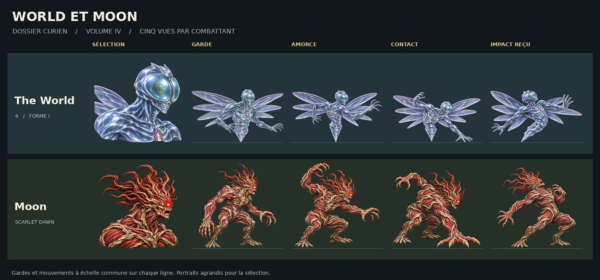

# The World et Moon

## The World • The House of the Dead 4

Au chapitre 6, le premier corps de The World dépasse du sol gelé. Sa tête étroite porte deux grandes surfaces bombées semblables aux yeux d’une libellule. Les ailes allongées s’écartent derrière ses épaules. Le thorax laisse voir un noyau. Le modèle paraissant en jeu a servi à choisir ces trois repères pour les dessinateurs et pour le viseur AMS. [SEGA, site du jeu](https://hod4.sega.jp/) · [Chapitre 6 et captures originales des différentes formes](https://www.k-triggerhappy.com/hod4/chapter6.html) · [Gros plan de la tête](https://www.k-triggerhappy.com/hod4/boss6A.jpg) · [Silhouette de la première forme](https://www.k-triggerhappy.com/hod4/boss6A-2.jpg)

Les captures montrent la main qui s’abat et les cristaux qui parcourent le sol. D’autres séquences du même combat introduisent une hache de glace et, après la transformation, des dragons de glace. Le dessin jouable développe la première forme. Son buste se termine par une petite embase de glace solidaire du sprite. Cette embase sert à le déplacer et à l’ancrer dans un duel vu de côté. Le détourage, l’épaisseur des ailes, le contraste du noyau et les quatre positions du corps ont été reconstruits pour cette vue. [Cristaux dans le jeu original](https://www.k-triggerhappy.com/hod4/boss6A-1.jpg) · [Deuxième forme, témoin de contrôle](https://www.k-triggerhappy.com/hod4/boss6B.jpg)

## Moon • House of the Dead Scarlet Dawn

Dans la dernière rencontre, Moon se développe progressivement. La tête apparaît d’abord, puis le bras droit se lève au-dessus de Ryan et de Kate. Lorsque le bas du corps se forme, une onde balaie la surface de l’eau. Les ailes apparaissent dans une séquence ultérieure. Le sprite jouable reprend le corps qui précède cette poussée des ailes. Les fibres rouge-brun et les plaques claires détachent les bras du torse. Des pointes ramifiées prolongent la tête. L’éclat au front reste lisible entre les pointes, y compris lorsque Moon se penche. [SEGA, fiche de Scarlet Dawn](https://www.sega.jp/arcade/detail/hod_scarlet-dawn/) · [Captures des dix séquences du combat](https://k-triggerhappy.com/blog/hod_scarletdawn-moon/) · [Bras droit levé](https://k-triggerhappy.com/blog/wp-content/uploads/2018/10/1023-03.jpg) · [Gros plan du front](https://k-triggerhappy.com/blog/wp-content/uploads/2018/10/1023-04.jpg)

La caméra du jeu d’arcade change d’échelle au cours de la croissance du géant. Pour la confrontation de profil, sa taille reste compatible avec celle des combattants humains et les appuis au sol prolongent ses fibres en forme de racines. La levée du bras et sa retombée ont été redessinées dans ce repère. [Formation du corps et onde](https://k-triggerhappy.com/blog/wp-content/uploads/2018/10/1023-07.jpg)

## Montage des poses

Chaque fichier contient un seul sujet détouré. Les portraits occupent un carré de 832 pixels. Les gardes, amorces, contacts et impacts reçus utilisent une texture haute de 1 024 pixels, un axe horizontal placé à la moitié de sa largeur et un sol à y = 960. Les mesures ci-dessous sont données depuis le coin supérieur gauche de la texture lorsque le combattant regarde vers la droite.

| Fichier | Dimensions | Pivot | Cible AMS |
|---|---|---|---|
| `world_guard.png` | 1712 × 1024 | 856 • 960 | 963 • 473 |
| `world_windup.png` | 1600 × 1024 | 800 • 960 | 737 • 443 |
| `world_contact.png` | 1696 × 1024 | 848 • 960 | 903 • 550 |
| `world_recoil.png` | 2000 × 1024 | 1000 • 960 | 1284 • 408 |
| `world_select.png` | 832 × 832 | — | — |
| `moon_guard.png` | 1024 × 1024 | 512 • 960 | 737 • 302 |
| `moon_windup.png` | 1248 × 1024 | 624 • 960 | 912 • 379 |
| `moon_contact.png` | 1456 × 1024 | 728 • 960 | 1191 • 453 |
| `moon_recoil.png` | 1024 × 1024 | 512 • 960 | 481 • 215 |
| `moon_select.png` | 832 × 832 | — | — |

Les quatre repères de The World suivent le noyau thoracique, ceux de Moon suivent l’œil du front. Dans la pose de contact, la main de The World se lit autour de (1 380, 885), celle de Moon autour de (1 195, 860). Les mesures portent sur le PNG source. Le moteur ramène ces coordonnées à l’échelle de la scène et les inverse quand les adversaires échangent de côté.
