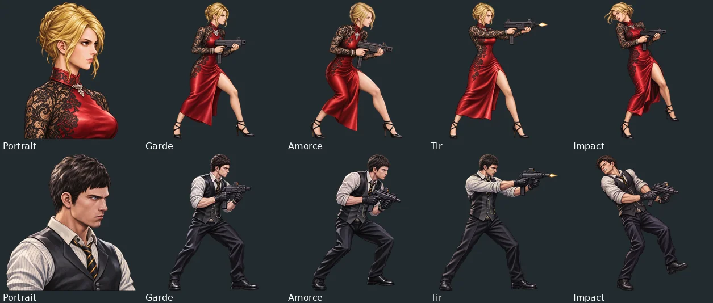

# Une réception au manoir Scarecrow

Au premier échange, on doit pouvoir reconnaître Kate à la ligne rouge de sa robe, même si elle passe devant les décombres et que Ryan occupe déjà la moitié du plan. Les manches en dentelle noire, la fente de la jupe et les cheveux blonds relevés reprennent sa silhouette dans *Scarlet Dawn*. Les manches claires retroussées de Ryan encadrent le gilet sombre, la cravate et les gants. Ces repères viennent des illustrations des personnages publiées par SEGA. Les postures de profil et la coiffe en mouvement ont été redessinées pour la caméra du mode combat. [Site de Scarlet Dawn](https://hod.sega.jp/) · [Illustration de Kate](https://hod.sega.jp/images/top/chara_player_img/01.png) · [Illustration de Ryan](https://hod.sega.jp/images/top/chara_player_img_uncompress/02.png)

## Choisir la tenue

À la sélection, ouvrez **Tenues de Kate et Ryan**, puis choisissez la ligne du personnage. Des pressions successives font défiler **Selon le dossier**, **Tenue du jeu 2D** et **Réception du manoir**. Avec « Selon le dossier », les deux agents portent leur tenue de réception dans les Chroniques de Scarlet Dawn. Un choix manuel vaut pour ce personnage des deux côtés du duel jusqu’à la fermeture du jeu. Sa portée, ses temps de récupération et ses cartouches sont identiques dans les deux costumes.

| Action | Kate | Ryan |
|---|---|---|
| Sélection | Portrait à contre-jour, dentelle et chignon lisibles à petite taille | Échelle identique, col clair et gilet |
| Garde | Les bras tiennent l’arme près du buste, la jambe avant ouvre la jupe | Le pied arrière soutient le buste, l’arme reste basse |
| Amorce | Le genou avant fléchit et le bras se prépare au tir | Le buste descend et la ligne des épaules avance |
| Contact | Les bras se tendent, l’éclair débute devant la bouche de l’arme | Le tir dessine une ligne horizontale au-dessus du coude |
| Impact reçu | Le haut du corps recule et le talon avant quitte le sol | Le buste bascule en arrière et le pied avant se lève |

### Recaler les effets après une retouche

Les deux sources de contact occupent un canevas de 1 024 × 1 024. Le pivot des pieds est (512, 960). Le départ du flash de Kate se situe vers (832, 226), celui de Ryan vers (904, 222), en pixels source depuis le coin supérieur gauche. Le moteur convertit le décalage entre pivot et bouche d’arme suivant la taille du personnage, puis le réfléchit lorsqu’il change de côté. La fumée et la pointe lumineuse dépassent ce repère. [Pose de Kate](../../../assets/dossier_curien/saga/kate_soiree_contact.png) · [Pose de Ryan](../../../assets/dossier_curien/saga/ryan_soiree_contact.png)

## Deux démarches pour deux agents

Gary Stewart, de *The House of the Dead 2*, conserve sa veste bleue et son arme tenue près du corps. Daniel Curien, de *III*, marche avec le canon plus bas et un pas plus lourd. Chacun reçoit deux dessins originaux pour les appuis opposés. À la cadence de 60 Hz, les images du cycle défilent toutes les six mises à jour de déplacement. Une foulée entière dure 24 tics, soit 0,4 seconde. En recul, l’ordre est inversé. Une frappe subie interrompt immédiatement le cycle et affiche la réaction d’impact.

| Tics de marche avant | Image | Repère |
|---|---|---|
| 1–6 | Premier pas | Une jambe s’étend, le talon prend le sol |
| 7–12 | Garde | Les appuis passent sous le corps |
| 13–18 | Deuxième pas | Le pied opposé mène la foulée |
| 19–24 | Garde | Retour à la phase de passage |

Les nouvelles poses ont leur axe à mi-largeur et leurs pieds à y = 960, comme les gardes qui s’intercalent entre elles. Le déplacement dans l’arène dépend de la vitesse du combattant. L’animation suit ses tics de marche au sol. [Premier pas de Gary](../../../assets/dossier_curien/saga/gary_walk1.png) · [Deuxième pas de Gary](../../../assets/dossier_curien/saga/gary_walk2.png) · [Premier pas de Daniel](../../../assets/dossier_curien/saga/daniel_walk1.png) · [Deuxième pas de Daniel](../../../assets/dossier_curien/saga/daniel_walk2.png)
