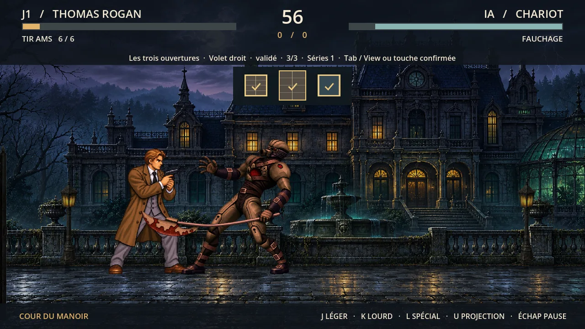

# De Pandore à l’Arche
Volume IV de la bible de Dossier Curien.

## De Pandore à l’Arche

En 2003, Kate Green et James Taylor affrontent The World sur le parvis de Goldman. Trois ans plus tard, Kate accompagne Ryan, le frère de James, au domaine Scarecrow. À travers les branches de Moon, ils aperçoivent la lueur de son front.

- Kate, James et The World sur le parvis du siège Goldman. · [hotd4_final.png](../../../assets/dossier_curien/saga/hotd4_final.png)

### Entrer par une histoire

Depuis Chroniques de la saga, choisissez The House of the Dead 4 puis Histoire pour suivre Kate ou incarner The World. Dans le dossier Scarlet Dawn, Ryan et Moon donnent accès à deux points de vue sur la chute du domaine. Le joueur retrouve ses commandes de duel dans les quatre parcours.

| Dans cette édition | Accès depuis le menu |
| --- | --- |
| 23 combattants, 25 parcours Histoire | Chroniques de la saga ou Histoire. Chaque nouveau boss a son introduction, son rival, son dernier adversaire et son épilogue. |
| 17 arènes, 5 circuits de gardiens | Duel contre IA ou Duel local pour choisir une arène. Boss Rush AMS pour le circuit De Pandore à l’Arche. |
| 9 dossiers, 29 archives et 69 exercices | Archives et variantes lance les adaptations des dérivés. Pendant l’Entraînement, la pause ouvre l’Atelier technique. |

Le texte et les illustrations des volumes I à III restent consultables dans l’intégrale. Les deux boss annoncés à la fin du volume III figurent désormais dans la sélection.

## The World

Deux volées hautes à douze tics d’intervalle. Sur touche, le givre ralentit la marche pendant 36 tics. Bas + spécial frappe à la hache et atteint une cible accroupie.

- Garde · [world_guard.png](../../../assets/dossier_curien/saga/world_guard.png)
- Amorce · [world_windup.png](../../../assets/dossier_curien/saga/world_windup.png)
- Frappe · [world_contact.png](../../../assets/dossier_curien/saga/world_contact.png)
- Impact reçu · [world_recoil.png](../../../assets/dossier_curien/saga/world_recoil.png)

| Commande | PV | Actif¹ | Fin¹ | Portée | Étourdi¹ |
| --- | --- | --- | --- | --- | --- |
| J · Léger | 7 | 5 | 17 | 125 | 10 |
| K · Lourd | 14 | 12 | 34 | 165 | 15 |
| L · Éclats de banquise | 7 × 2 | 18 | 58 | 590 | 12 |
| Bas + L · Hache de givre | 18 | 14 | 42 | 216 | 18 |
| U · Projection | 16 | 7 | 39 | 94 | 20 |

¹ Tics de simulation à 60 Hz. « Actif » donne le premier tic où l’attaque peut toucher, « Fin » le retour au neutre. Le premier contact d’une attaque mobile dépend de la distance. La portée est exprimée dans le repère horizontal de 1 280 unités.

### Provoquer la hache

À longue portée, les deux fronts d’éclats se déplacent de 70 à 590 unités. Chaque passage couvre une bande étroite. Après un impact confirmé, la marche du rival est réduite de moitié pendant 36 tics. Accroupi, le joueur laisse passer les éclats hauts. En s’approchant à moins de 216 unités, il entre à portée de la hache.

### Finition · Dernier hiver

Neuf facettes se referment sur le rival. Après un arrêt au centre, les éclats repartent vers l’extérieur. La pointe inférieure du corps de The World sert de repère au sol pendant l’échange.

- Éclats de banquise · duel Godot
- Dernier hiver · finition Godot

[Voir les captures dans la bible illustrée, page 2](HOTD_Bible_IV_De_Pandore_a_l_Arche.pdf#page=2)

## Moon

Le bras court près du sol. Sautez au-dessus de son extrémité. Bas + spécial aspire les cibles entre 150 et 405 unités. Le corps à corps échappe au cyclone.

- Garde · [moon_guard.png](../../../assets/dossier_curien/saga/moon_guard.png)
- Amorce · [moon_windup.png](../../../assets/dossier_curien/saga/moon_windup.png)
- Frappe · [moon_contact.png](../../../assets/dossier_curien/saga/moon_contact.png)
- Impact reçu · [moon_recoil.png](../../../assets/dossier_curien/saga/moon_recoil.png)

| Commande | PV | Actif¹ | Fin¹ | Portée | Étourdi¹ |
| --- | --- | --- | --- | --- | --- |
| J · Léger | 7 | 5 | 17 | 125 | 10 |
| K · Lourd | 20 | 18 | 46 | 191 | 19 |
| L · Bras de l’Arche | 19 | 22 | 62 | 522 | 18 |
| Bas + L · Appel du cyclone | 11 | 25 | 55 | 405 | 19 |
| U · Projection | 16 | 7 | 39 | 94 | 20 |

¹ Tics de simulation à 60 Hz. « Actif » donne le premier tic où l’attaque peut toucher, « Fin » le retour au neutre. Le premier contact d’une attaque mobile dépend de la distance. La portée est exprimée dans le repère horizontal de 1 280 unités.

### Choisir la hauteur du saut

Le bras balaie le sol de 68 à 522 unités. Son extrémité progresse pendant 18 tics. Un saut assez haut la franchit. Si Moon lit ce saut, le cyclone touche entre 150 et 405 unités et attire le rival de 78 unités. Au contact, l’aspiration laisse une zone libre suffisamment grande pour tenter la projection.

### Finition · Éclipse de l’Arche

Six ramifications se redressent autour du dernier impact. Au troisième temps, un éclair fend leur centre. Le visage reste cadré sous la couronne d’échardes.

- Bras de l’Arche · duel Godot
- Éclipse de l’Arche · finition Godot

[Voir les captures dans la bible illustrée, page 3](HOTD_Bible_IV_De_Pandore_a_l_Arche.pdf#page=3)

## The World en trois actes

Les cartes restituent les quatre moments de la route personnelle. Les rencontres dans le métro et le hall procèdent d’une simulation de l’AMS.

- I · Introduction · [world_intro.png](../../../assets/dossier_curien/saga/world_intro.png)
- II · Rival · [world_rival.png](../../../assets/dossier_curien/saga/world_rival.png)

### James Taylor • Métro souterrain

Le relevé AMS dépose le sujet β sur le quai du métro. Une ligne de glace court jusqu’aux pieds de James. Dans le verre d’une rame, le cœur de The World bat encore.

### Justice • Métro souterrain

Entre deux rames, Justice se libère du givre. Ses quatre mains cherchent le même appui sur les portes gelées. The World relève son bras.

- III · Dernier adversaire · [world_final.png](../../../assets/dossier_curien/saga/world_final.png)
- Épilogue · [world_ending.png](../../../assets/dossier_curien/saga/world_ending.png)

### Kate Green • Parvis du siège Goldman

La cour de Goldman a remplacé les rails. Kate se tient au bord de la dalle fendue. Dans le cœur de la créature, elle distingue la lueur de sa propre lampe.

### Épilogue

Les dalles de la cour se réchauffent. Un éclat de glace tient encore dans la paume d’un gant abandonné. Lorsqu’il fond, l’AMS arrête l’enregistrement.

### Règle du dossier

Fenêtre de ravitaillement. La première série de trois touches recharge le magasin du combattant qui l’a réussie.

## Moon en trois actes

Les cartes restituent les quatre moments de la route personnelle. Les rencontres dans le métro et le hall procèdent d’une simulation de l’AMS.

- I · Introduction · [moon_intro.png](../../../assets/dossier_curien/saga/moon_intro.png)
- II · Rival · [moon_rival.png](../../../assets/dossier_curien/saga/moon_rival.png)

### Kate Green • Réception de Scarecrow Mansion

Dans le hall de Scarecrow Mansion, une racine perce le dallage devant Kate. Le relevé AMS ramène le corps de Moon à l’échelle du hall. La poussière monte jusqu’au plafond.

### James Taylor • Réception de Scarecrow Mansion

Le simulateur projette James devant un vitrail brisé. Son reflet se disperse à mesure que les feuilles se soulèvent autour de Moon.

- III · Dernier adversaire · [moon_final.png](../../../assets/dossier_curien/saga/moon_final.png)
- Épilogue · [moon_ending.png](../../../assets/dossier_curien/saga/moon_ending.png)

### Ryan Taylor • Ruines du domaine Scarecrow

Sur le parvis, Ryan entend Kate derrière lui. Le front de Moon émerge des branches et le dernier duel du relevé commence sous l’orage.

### Épilogue

Après l’éclair, le vent retombe devant les marches. Sur la pierre mouillée, une rose bleue tient encore à sa tige. Le microphone ne capte plus que la pluie.

### Règle du dossier

Éclairage de secours. Un coup lourd confirmé repousse l’adversaire de 60 unités supplémentaires, une fois par manche.

## Le dernier regard des agents

James déclenche l’autodestruction de son PDA pour arrêter The World. Dans Scarlet Dawn, Ryan plante une tige de métal dans la tête de Moon. La foudre frappe la tige. Les derniers actes reprennent le boss et le lieu de leur épisode, puis se referment sur un souvenir écrit pour le dossier.

- Kate et The World au siège de Goldman · [hotd4_final.png](../../../assets/dossier_curien/saga/hotd4_final.png)
- Ryan et Moon au domaine Scarecrow · [scarlet_final.png](../../../assets/dossier_curien/saga/scarlet_final.png)

### Kate Green • James Taylor, puis Justice, puis The World

Dans la cour de Goldman, James couvre la sortie pendant que Kate observe le cœur de The World. Une lame de glace se forme au bout du bras de la créature.

Le relevé de Kate s’arrête à la voix de James sur le parvis. L’AMS repasse la première image du quai. Dans la vitre de la rame, ils sont encore deux.

### Ryan Taylor • Kate Green, puis James Taylor, puis Moon

Sur le parvis de l’église de Thornheart, des pierres montent vers la cime de Moon. Ryan retrouve Kate au pied des marches. Lorsque le vent tourne, un troisième œil apparaît sur le front de la créature.

La dernière image de l’église brûle sous l’éclair. L’AMS revient à la réception du manoir. Ryan y reconnaît la fenêtre par laquelle Kate repérait les sorties.

### Lecture AMS

Dans ces deux rencontres finales, le briefing et la pause permettent de régler l’analyse du point faible. Le repérage dure 45 tics à partir du tic 90. L’ouverture suit pendant 42 tics. Un lourd ou un spécial confirmé pendant l’ouverture rapporte six dégâts supplémentaires et porte l’étourdissement à au moins 23 tics, une fois par cycle de quatre secondes.

- Le noyau du thorax · capture Godot
- L’œil du front · capture Godot

[Voir les captures dans la bible illustrée, page 6](HOTD_Bible_IV_De_Pandore_a_l_Arche.pdf#page=6)

## Parvis du siège Goldman

Le combat de The World se situe en bas de la tour. L’horizon ferme la cour et les bandes circulaires guident le regard vers le sujet β.

- Le cercle rouge traverse le parvis. · [worldstage_back.png](../../../assets/dossier_curien/saga/worldstage_back.png) + [worldstage_mid.png](../../../assets/dossier_curien/saga/worldstage_mid.png) + [worldstage_front.png](../../../assets/dossier_curien/saga/worldstage_front.png)

| Plan | Montage adapté au duel |
| --- | --- |
| Fond • 17 | La façade domine une cour de béton. Le marquage rouge et le givre donnent à la glace une surface où se lire. |
| Médian • 32 | À gauche, un module de parement et sa grille disparaissent derrière les épaules des combattants. |
| Avant • 58 | À droite, le pavement soulevé et les éclats passent devant le bord de l’aire. Le centre reste dégagé pour lire les deux volées. |

Les trois images mesurent 1 600 × 900 pixels. Les coefficients donnent le déplacement horizontal pour une unité de dérive. Le sol du duel se trouve à y = 601 dans la vue logique de 1 280 × 720.

- Prise de vue du duel dans le moteur Godot.

[Voir les captures dans la bible illustrée, page 7](HOTD_Bible_IV_De_Pandore_a_l_Arche.pdf#page=7)

## Ruines du domaine Scarecrow

L’église a cédé sous l’orage. Une bande continue de pierre humide réunit les vestiges et donne aux deux adversaires une aire de combat stable.

- La tour et les pans de mur marquent l’ancien domaine. · [moonstage_back.png](../../../assets/dossier_curien/saga/moonstage_back.png) + [moonstage_mid.png](../../../assets/dossier_curien/saga/moonstage_mid.png) + [moonstage_front.png](../../../assets/dossier_curien/saga/moonstage_front.png)

| Plan | Montage adapté au duel |
| --- | --- |
| Fond • 17 | Le ciel, la tour claire et la terrasse fixent les grandes distances dans les ruines. |
| Médian • 32 | Une baie de pierre brisée encadre le côté droit, derrière les combattants. |
| Avant • 58 | Le fragment de balustrade à gauche glisse plus vite que la tour. Les racines et la main de Moon gardent leur silhouette au centre. |

Les trois images mesurent 1 600 × 900 pixels. Les coefficients donnent le déplacement horizontal pour une unité de dérive. Le sol du duel se trouve à y = 601 dans la vue logique de 1 280 × 720.

- Prise de vue du duel dans le moteur Godot.

[Voir les captures dans la bible illustrée, page 8](HOTD_Bible_IV_De_Pandore_a_l_Arche.pdf#page=8)

## Les tenues de réception

Au manoir Scarecrow, Kate porte une robe rouge fendue, des manches en dentelle noire et un chignon blond. Chez Ryan, les manches claires retroussées encadrent un gilet sombre et une cravate. Ces détails permettent de suivre l’agent actif lorsque les deux silhouettes se croisent.

- Portrait · [kate_soiree_select.png](../../../assets/dossier_curien/saga/kate_soiree_select.png)
- Garde · [kate_soiree_guard.png](../../../assets/dossier_curien/saga/kate_soiree_guard.png)
- Amorce · [kate_soiree_windup.png](../../../assets/dossier_curien/saga/kate_soiree_windup.png)
- Contact · [kate_soiree_contact.png](../../../assets/dossier_curien/saga/kate_soiree_contact.png)
- Impact reçu · [kate_soiree_recoil.png](../../../assets/dossier_curien/saga/kate_soiree_recoil.png)
- Portrait · [ryan_soiree_select.png](../../../assets/dossier_curien/saga/ryan_soiree_select.png)
- Garde · [ryan_soiree_guard.png](../../../assets/dossier_curien/saga/ryan_soiree_guard.png)
- Amorce · [ryan_soiree_windup.png](../../../assets/dossier_curien/saga/ryan_soiree_windup.png)
- Contact · [ryan_soiree_contact.png](../../../assets/dossier_curien/saga/ryan_soiree_contact.png)
- Impact reçu · [ryan_soiree_recoil.png](../../../assets/dossier_curien/saga/ryan_soiree_recoil.png)

### Choisir une tenue

À la sélection, ouvrez Tenues de Kate et Ryan. Chaque pression fait défiler le choix du personnage ciblé. « Selon le dossier » équipe automatiquement la tenue de réception dans Scarlet Dawn. « Tenue du jeu 2D » rétablit le modèle ordinaire. « Réception du manoir » impose la tenue de soirée, y compris en duel libre.

### Lire le même coup sous deux costumes

Dans l’entraînement, essayez une rafale avec chacun. Comparez le pied d’appui, la remontée de l’arme pendant l’amorce et la ligne des épaules à l’impact. Les coups, la portée et les délais appartiennent au combattant. Le costume remplace son portrait et ses poses. Le choix s’applique aux deux côtés du duel pendant la session.

[SEGA · Illustrations de Kate et Ryan sur le site japonais de Scarlet Dawn](https://hod.sega.jp/)

[Entretien de production · Tenues de réception et recherches de silhouettes](https://cgworld.jp/feature/201810-cgw243-hod.html)

## Deux marches en quatre temps

Gary garde son pistolet près du buste. Daniel porte son arme longue à deux mains. Les nouvelles poses conservent cette différence pendant le passage d’un appui à l’autre.

- Gary · appui 1 · [gary_walk1.png](../../../assets/dossier_curien/saga/gary_walk1.png)
- Passage par la garde · [gary_guard.png](../../../assets/dossier_curien/saga/gary_guard.png)
- Gary · appui 2 · [gary_walk2.png](../../../assets/dossier_curien/saga/gary_walk2.png)
- Retour à la garde · [gary_guard.png](../../../assets/dossier_curien/saga/gary_guard.png)
- Daniel · appui 1 · [daniel_walk1.png](../../../assets/dossier_curien/saga/daniel_walk1.png)
- Passage par la garde · [daniel_guard.png](../../../assets/dossier_curien/saga/daniel_guard.png)
- Daniel · appui 2 · [daniel_walk2.png](../../../assets/dossier_curien/saga/daniel_walk2.png)
- Retour à la garde · [daniel_guard.png](../../../assets/dossier_curien/saga/daniel_guard.png)

| Fenêtre à 60 Hz | Avance au sol |
| --- | --- |
| Tics 1 à 6 | Première pose de marche. Le pied engagé indique le sens du déplacement. |
| Tics 7 à 12 | Retour par la garde entre les deux appuis. |
| Tics 13 à 18 | Deuxième pose de marche. |
| Tics 19 à 24 | Second retour par la garde avant la répétition du cycle. |

Le moteur lit les quatre temps en sens inverse lors du recul en garde. L’arrêt réinitialise le compteur. Dès qu’un coup ou un étourdissement commence, l’animation correspondante prend le relais.

- Gary avance · capture Godot
- Daniel change d’appui · capture Godot

[Voir les captures dans la bible illustrée, page 10](HOTD_Bible_IV_De_Pandore_a_l_Arche.pdf#page=10)

## Les 69 exercices

Trois familles d’exercices sont proposées à chacun des 23 combattants. Un joueur qui sait projeter avec Gary doit encore découvrir à quelle distance le spécial de Moon atteint son rival.

### Entrer et lire le journal

Choisissez Entraînement, votre combattant et un partenaire. Depuis la pause, ouvrez l’Atelier technique. La cadence peut être réglée sur Temps réel, Ralenti × 0,5 ou Image par image. Dans ce dernier mode, commandez le coup puis appuyez sur le point, N ou le stick droit pour avancer d’un tic.

| Exercice | Action et condition de réussite |
| --- | --- |
| Briser la garde | Le mannequin garde. À courte portée, pressez U au clavier ou Y à la manette. La projection doit atteindre le mannequin pendant qu’il garde. |
| Confirmer le lourd | Touchez avec J puis engagez K pendant la récupération du léger confirmé. L’exercice se termine quand le lourd issu de cet enchaînement atteint le rival. |
| Toucher avec le spécial | Trouvez la distance à laquelle L ou B atteint l’adversaire. Le placement initial dépend de la portée de votre personnage. L’exercice se valide sur une touche franche. |

### Observer un échange

Le journal indique le tic, le nom du coup, la réponse du mannequin et les PV effectivement retirés. Il conserve les trois derniers impacts. La coche d’un exercice est enregistrée pour ce combattant sur l’appareil. Recommencer conserve cette coche et vide le journal du nouvel échange.

### Exemple avec Moon

En image par image, lancez le Bras de l’Arche et faites avancer le jeu jusqu’au premier tic actif. Continuez jusqu’à ce que le bout du bras arrive au mannequin. Le décalage entre ces deux tics montre combien la distance modifie le moment de la touche.

- Menu Atelier technique · version navigateur
- L · Le bras balaie le sol

[Voir les captures dans la bible illustrée, page 11](HOTD_Bible_IV_De_Pandore_a_l_Arche.pdf#page=11)

## De Pandore à l’Arche

L’ordre des trois adversaires change la décision de ravitaillement. Justice menace au corps à corps. The World couvre la distance avec deux volées. Moon rend dangereux le retour au sol après un saut.

| Manche | Gardien | Terrain |
| --- | --- | --- |
| 1 | Justice | Métro souterrain |
| 2 | The World | Parvis du siège Goldman |
| 3 | Moon | Ruines du domaine Scarecrow |

- Briefing du circuit · version navigateur
- Dernier adversaire · Moon

[Voir les captures dans la bible illustrée, page 12](HOTD_Bible_IV_De_Pandore_a_l_Arche.pdf#page=12)

### Garder des ressources

Une seule manche décide de chaque duel. La vie et les cartouches de votre combattant passent à l’étape suivante. Un soin rend 18 PV pour cinq secondes au classement. Remplir le chargeur coûte trois secondes. Repartir immédiatement conserve le temps.

### Décider après Justice

Une fois le premier gardien vaincu, observez les PV et les cartouches avant de choisir un seul service. Contre The World, passer sous les éclats conserve le chargeur pour la riposte. Au combat suivant, surveillez la hauteur du bras de Moon avant d’utiliser votre dernier spécial.

### Fin du circuit

L’égalité envoie les deux combattants à un point de vie pour dix secondes. Une seconde égalité termine la tentative. Le K.-O. du dernier boss ouvre la finition. Le meilleur temps est enregistré par circuit et par combattant.

## Ce que montre le jeu original

Le volume IV conserve le choix de forme des deux boss et les repères des lieux. Les récits de l’AMS et la mécanique de duel emploient leur propre mise en scène.

| Élément | Référence et limite de l’adaptation |
| --- | --- |
| The World | La première forme porte les yeux et les ailes de libellule. Le noyau se lit dans le thorax. La seconde forme et les dragons de glace du jeu d’arcade restent hors de son répertoire jouable. |
| Moon | La pousse des membres puis celle des ailes sont distinctes dans l’épisode d’origine. Le dessin jouable choisit Moon avant les ailes. Les appuis et la taille sont adaptés au cadre de profil. |
| Décors et récit | Le parvis de Goldman et le domaine détruit appartiennent aux épisodes d’origine. Les plans écartés pour la parallaxe, les duels du simulateur et les épilogues personnels sont composés pour l’anthologie. |
| Actions à produire | Gary et Daniel possèdent leurs deux appuis de marche. Plusieurs autres combattants utilisent encore une transformation de pose pour avancer, sauter ou récupérer. Les formes ultérieures des deux boss et leurs changements d’échelle restent à développer. |

[SEGA · Site japonais de The House of the Dead 4](https://hod4.sega.jp/)

[The House of the Dead 4 · Captures successives du sixième chapitre](https://www.k-triggerhappy.com/hod4/chapter6.html)

[Scarlet Dawn · Phases de la rencontre avec Moon](https://k-triggerhappy.com/blog/hod_scarletdawn-moon/)

[SEGA · Fiche de la borne Scarlet Dawn](https://www.sega.jp/arcade/detail/hod_scarlet-dawn/)

[Équipe de production · Personnages et recherche des costumes](https://cgworld.jp/feature/201810-cgw243-hod.html)

Les feuilles de production accompagnant la bible donnent les pivots et les cibles des huit poses (REFERENCES_COMBATTANTS_IV.md), le montage des six calques (SOURCES_ARENES_IV.md) et le raccord du départ des tirs aux armes des deux agents (TENUES_ET_MARCHE_IV.md).

## House of the Dead Reawakened

Le 28 octobre 2026, SEGA Amusements International annonce la première mondiale de son attraction VR à l’IAAPA Expo d’Orlando, du 17 au 20 novembre. La fiche de la borne présente trois missions à jouer seul ou en coopération à deux.

### Deux volets et une porte

La façade du manoir utilise deux écrans verticaux de 43 pouces pour les fenêtres latérales. Un écran de 85 pouces figure la porte verrouillée. Les fenêtres s’ouvrent puis la porte apparaît grande ouverte. À l’intérieur, chaque joueur enfile un casque DPVR E4C. L’image, le retour tactile de la manette et le son individuel accompagnent le tir.

### Les trois ouvertures

Dans Archives et variantes, sélectionnez House of the Dead: Reawakened. Le défi se joue en duel devant le manoir Curien. Trois signaux successifs reprennent les ouvertures de la façade. Une pression sur Tab au clavier ou View à la manette valide le signal ouvert. Une frappe confirmée pendant cette fenêtre le valide aussi.

| Signal | Place dans le cycle | Fenêtre de confirmation |
| --- | --- | --- |
| 1 · Volet gauche | Tics 0 à 119 | 48 à 95 inclus |
| 2 · Porte de face | Tics 120 à 239 | 168 à 215 inclus |
| 3 · Volet droit | Tics 240 à 359 | 288 à 335 inclus |

- Les trois ouvertures dans le duel de l’anthologie · capture Godot.

[Voir les captures dans la bible illustrée, page 14](HOTD_Bible_IV_De_Pandore_a_l_Arche.pdf#page=14)

Chaque fenêtre dure 0,8 seconde à 60 Hz. Une ouverture manquée ramène la série à zéro. Trois réussites consécutives retirent 12 PV au rival, garantissent au moins 14 tics d’étourdissement et ajoutent un point au compteur. Cette épreuve de rythme a été conçue pour le mode de combat 2D.

[SEGA Amusements International · Annonce du 28 octobre 2026 et présentation à Orlando](https://segaarcade.com/news/dare-to-experience-house-of-the-dead-reawakened)

[SEGA Amusements International · Dispositif de la borne, modes et nombre de missions](https://segaarcade.com/games/house-of-the-dead-reawakened)

### Feuilles de production

- [Pivots et cibles de The World et de Moon](REFERENCES_COMBATTANTS_IV.md)
- [Montage des décors en parallaxe](SOURCES_ARENES_IV.md)
- [Tenues de réception et marches de Gary et Daniel](TENUES_ET_MARCHE_IV.md)
