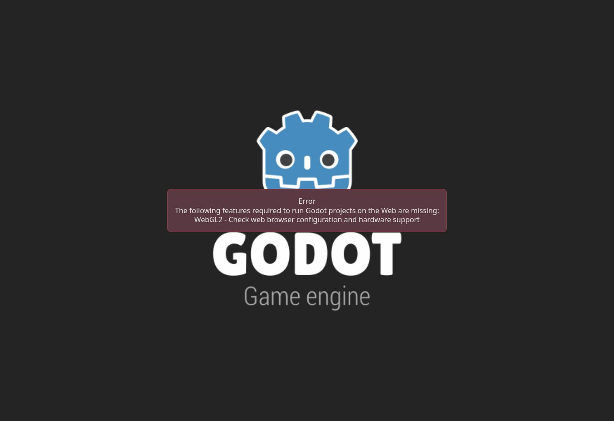

# Contrôle visuel de l’expansion — 19 novembre 2026

## Périmètre

Le contrôle utilise Godot **4.7.1 stable**, avec le rendu Compatibility, OpenGL 4.5 et Mesa llvmpipe. Les captures natives proviennent directement du viewport 1280 × 720 du moteur ; elles ne sont ni composées ni retouchées.

Les cinq premières captures portent sur les sources consolidées avant l’ajout des trois dessins bas. Les trois dernières proviennent du **PCK final de 95 935 632 octets**, empreinte SHA-256 `690ebbb7f1c82cc9954ac474ff5b87e9e8a6b29f6fb714ae698ab4c71c7733a3`.

Les menus de sélection ont été parcourus manuellement. Le contrôle final des poses basses utilise ensuite un lanceur de test qui charge l’arène depuis le PCK, place Linda face à Chariot au poste de sécurité EFI et active la cadence image par image. Il fixe la distance initiale pour observer l’impact de la glissade. Les commandes d’accroupissement, de garde, d’attaque, d’avancement et de pause sont envoyées par le clavier de l’interface.

## Observations natives

| Capture | Observation |
|---|---|
| [01 — Bestiaire EX](qa_native/01_bestiary_ex.png) | Le filtre affiche les sept sujets EX. La taille du panneau est recalculée et les boutons restent utilisables. La deuxième page présente Zobio et Zobiko. |
| [02 — Fiche Linda](qa_native/02_linda_bestiary.png) | Illustration entière, transparence correcte, texte et accès « Jouer Linda ». Le bouton mène au choix de l’adversaire, puis de l’arène et au duel. |
| [03 — Tir debout](qa_native/03_linda_standing_shot.png) | Contact à l’image 11, départ du projectile au canon, consommation d’une cartouche et impact de 10 PV. |
| [04 — Appui gauche](qa_native/04_linda_walk_left_contact.png) | La jambe gauche avance ; la jambe droite avec l’étui reste en arrière. Les pieds suivent le sol. |
| [05 — Appui droit](qa_native/05_linda_walk_right_contact.png) | L’autre jambe avance. Les deux contacts ne répètent plus le même appui. |
| [06 — Accroupissement](qa_native/06_linda_crouch.png) | Jambes repliées, bassin abaissé, proportions de la tête et du torse conservées. |
| [07 — Garde accroupie](qa_native/07_linda_crouch_guard.png) | Bras gauche bandagé protégeant le visage, arme conservée, affichage « GARDE ». |
| [08 — Glissade armée](qa_native/08_linda_slide_shot.png) | À l’image 19, tir aligné avec le canon, munitions de 8 à 7, déplacement au sol et impact de 12 PV. Le HUD nomme bien la variante. |

Après la dernière capture, ouverture de la pause, accès à l’atelier et reprise de l’entraînement : le combat et son HUD réapparaissent immédiatement, sans appui sur N. Ce contrôle confirme la correction du rafraîchissement en cadence image par image.

La revue a également confirmé les filtres Tous/Zombie Revenge/EX, la pagination, le retour à la liste et la fiche de Black Magician. La régression de mise en page du filtre EX a été reproduite, corrigée et contrôlée dans l’interface ainsi que par le test ciblé.

## Essai web

Le serveur `Jouer.py` a été lancé sur `http://127.0.0.1:28716/`. La page HTML, le JavaScript et les icônes ont été servis avec succès. Avant de démarrer le moteur, Chromium affiche :

> WebGL2 - Check web browser configuration and hardware support

Le résultat persiste après **un rechargement**. Aucun changement de protection ou de configuration graphique du navigateur n’a été effectué. Le paquet web est préparé ; **son exécution dans le navigateur n’est pas validée dans cet environnement**. Le lanceur Windows n’a pas été exécuté sur ce système Linux.

## Limites et preuves

Ce contrôle couvre les scénarios observés, pas tous les duels ni tous les enchaînements. Les poses de passage, sauts et autres dessins manquants restent recensés dans [MANQUANTS_COMPLEMENT.json](MANQUANTS_COMPLEMENT.json). Le pilote audio final était Dummy ; aucune validation par écoute n’est revendiquée.

Les empreintes des captures et journaux sont conservées dans [VISUAL_QA.json](VISUAL_QA.json). Les suites automatiques et le chargement des textures du paquet sont détaillés dans [PACK_QA.json](PACK_QA.json) et le [rapport de production](RAPPORT.md).
